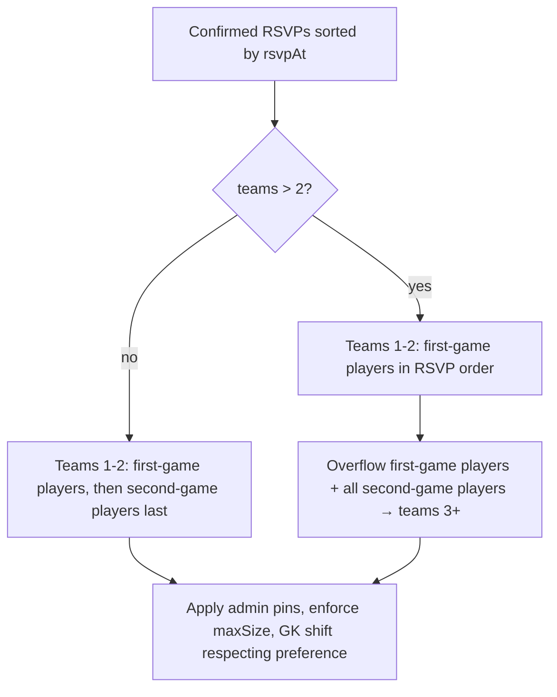

# Team size + game-slot RSVP

Let club admins set players per team (which drives how many teams, and therefore how many games, a match day has), and let players RSVP for the **1st game** (default) or the **2nd game**, with a remembered per-schedule-slot default (e.g. "2nd game on Wednesdays, 1st game on Mondays").

## Status

| Field               | Value                        |
| ------------------- | ---------------------------- |
| Status              | planned                      |
| Owner session       | —                            |
| Last updated        | 2026-11-09                   |
| Related PR / branch | `orkun/loving-bohr-tiii0n` (plan only) |

## Goals (v1)

- **Configurable team size** — club admins set players per team (club default → schedule slot → match). Team count, roster-fill meter, and every generator/rebalance/transfer path use it instead of the hard-coded `11`.
- **Game preference on RSVP** — each RSVP carries `gamePreference: 'first' | 'second'`, default `'first'`. Team generation fills teams 1–2 (Game 1) with first-game players and puts second-game players on teams 3+ (Game 2).
- **Remembered defaults per schedule slot** — a player can save "2nd game" for a recurring slot (e.g. the Wednesday 7pm slot of a weekly schedule). New RSVPs for matches materialized from that slot pre-select it. Everything else defaults to 1st game.
- **Out of scope for v1:** game formats (winner-stays vs. 2v2 parallel), per-game start times, per-game check-in, a max-teams / field cap, waitlists, auto-RSVP from recurring preferences, more than two game groups ("3rd game").

## Proposed product rules

These are the recommendations this plan is built on. Items marked **(confirm)** are the owner's call before implementation starts; see [Open questions](#open-questions).

1. **Game groups.** Teams 1–2 are **Game 1**. Teams 3+ are **Game 2**. This matches today's generator, which already treats teams 1–2 specially (1 GK cap, "keep 11 v 11") and puts overflow on 3+.
2. **Team count** stays `computeTeamCountForRSVPCount(confirmed, teamSize, 2)`: a 3rd team appears once confirmed RSVPs exceed `2 × teamSize`. Only the size input changes.
3. **Placement priority.** Within each group, RSVP order (earliest first) still wins, as today.
   - First-game players fill teams 1–2 first. If more first-game players RSVP than Game 1 holds, the overflow goes to Game 2 as today.
   - Second-game players go to teams 3+.
   - **No Game 2 yet** (total confirmed ≤ `2 × teamSize`): second-game players are placed on teams 1–2 *after* every first-game player, and the UI says "No 2nd game yet: you're on Team X; arriving late is fine". **(confirm)**
4. **Promotions don't override preference.** When a Game 1 spot opens (cancellation backfill from [rsvp-cancellation-order](./rsvp-cancellation-order-feature-plan.md), GK shifting), promote eligible first-game players only. A second-game player is promoted only when no first-game candidate exists. **(confirm)**
5. **Admin pins win.** `manualTeamAssignments` and admin transfers override preference, as they already override RSVP order.
6. **Team size bounds:** 3–11 (5-a-side to full-sided). Changing a match's size after teams exist runs the existing regenerate path, keeping saved admin pins.
7. **Preference changes** after RSVP go through `PATCH /api/rsvp` under the match lock: remove from the current team (with backfill), then place incrementally. Same past-match lock as position edits.

## Todos

### Phase 1: configurable team size (no player-facing change at the default 11)

1. Add `teamSize?: number | null` to `Match`, `ScheduleSlot`, and `ClubSettings.defaultTeamSize`. Add `resolveTeamSize({ match, slot, club })` in `lib/teams/teamSize.ts` (match → slot → club → `DEFAULT_TEAM_SIZE`), clamped 3–11. Unit test it.
2. Snapshot `teamSize` onto the match in `createMatchDoc` / `materializeSchedule` so a later schedule edit does not silently resize existing matches.
3. Replace hard-coded `11` with the resolved size in `expandTeamsForMatch`, `placeGkOnTeamWithoutGk`, `removeUserFromMatchTeams`, `compactTeamVacancies`, the rebalance route, `teamService`, and `teamGenerator` call sites. Keep `Team.maxSize` written from the resolved size.
4. Admin UI: team-size field on club settings, `ScheduleForm` slot rows, and `EditMatchCard`. Validate with Zod in the corresponding API routes (`verifyClubAdmin` / `verifyClubAdminForMatch`).
5. Match edit with changed `teamSize` → `expandTeamsForMatch(..., { forceRegenerate: true })` under `acquireMatchLock`; audit-log the change.
6. `getRosterFill` / `RosterFillMeter` / `NextMatchHero` take the match's size. Copy reads e.g. "4 spots to fill 2 teams of 7".

### Phase 2: per-RSVP game preference (behind a LaunchDarkly flag)

7. Add `gamePreference?: 'first' | 'second'` to `RSVP` / `RSVPFirestore` (missing = `'first'`). Map it in every RSVP reader (`expandTeamsForMatch` mapping, services, admin lists).
8. `POST /api/rsvp` accepts `gamePreference`; `PATCH /api/rsvp` allows the owner (or a club admin) to change it per rule 7.
9. Generator: split the sorted pool into first/second before filling. Update `generateTeamsWithReplacements`, `assignUnassignedPlayersToTeams`, `shiftGoalkeepersOntoTeamsWithoutGk`, `enforceTeamMaxSizes` overflow, and the cancellation-backfill candidate filter. Table-driven tests for: no Game 2, exact boundary (`2 × teamSize` and `+1`), all-second, GK only in Game 2, admin pin against preference, preference flip after teams exist.
10. RSVP UI: segmented "1st game / 2nd game" next to the RSVP button with helper text "2nd game happens when more than N players RSVP". Changeable while RSVP is open.
11. Teams UI: group `TeamsDisplay` / `TeamToggle` under "Game 1" and "Game 2" headers; badge second-game players in `RsvpOrderCard` and rosters; show "No 2nd game yet" state.
12. LaunchDarkly flag (e.g. `game-preference-rsvp`) gates 8's new body field in the UI and all of 10–11. Server accepts the field regardless, so turning the flag off just stops new second-game picks.

### Phase 3: remembered defaults per schedule slot

13. Store defaults on the membership doc `clubMemberships/{clubId}_{uid}` as `gamePreferenceDefaults: Record<'<scheduleId>:<slotId>', 'second'>` (only non-default values stored). Writes via a new `PUT /api/clubs/[clubId]/members/me/game-preferences` (`verifyAuth` + active membership); rules keep `allow write: if false`.
14. Resolve at RSVP time: explicit body value → membership default for `match.scheduleId:match.scheduleSlotId` → `'first'`. Return the resolved value with the match so the UI pre-selects it.
15. UI: "Remember for every Wednesday 7:00pm" checkbox next to the picker (only for scheduled matches), plus a "My game preferences" list on the club/profile page that names each slot (schedule name, weekday, time) with a clear button.
16. Orphan handling: slots deleted from a schedule leave dead keys; ignore them on read and drop them on the next write. No migration.

## Current state

- **Team size is hard-coded to 11** across [`lib/teams/expandTeamsForMatch.ts`](../../lib/teams/expandTeamsForMatch.ts), [`lib/utils/teamGenerator.ts`](../../lib/utils/teamGenerator.ts), [`lib/teams/placeGkOnTeamWithoutGk.ts`](../../lib/teams/placeGkOnTeamWithoutGk.ts), [`lib/teams/removeUserFromMatchTeams.ts`](../../lib/teams/removeUserFromMatchTeams.ts), [`lib/teams/compactTeamVacancies.ts`](../../lib/teams/compactTeamVacancies.ts), [`app/api/teams/rebalance/route.ts`](../../app/api/teams/rebalance/route.ts), [`lib/services/teamService.ts`](../../lib/services/teamService.ts). [`lib/utils/rosterFill.ts`](../../lib/utils/rosterFill.ts) exports `DEFAULT_TEAM_SIZE = 11`.
- **Team count** comes from `computeTeamCountForRSVPCount(n, 11, 2)`: 2 teams until 23 RSVPs, then a 3rd, etc. It already takes a size parameter.
- **Teams 1–2 vs 3+ are already treated differently** in `generateTeamsWithReplacements` (1 GK cap on teams 1–2, none on overflow). There is no "game" concept in data or UI; `TeamToggle` just lists teams.
- **RSVP** ([`types/rsvp.ts`](../../types/rsvp.ts), [`app/api/rsvp/route.ts`](../../app/api/rsvp/route.ts)): `confirmed | cancelled`, per-RSVP `position`, written by the API under `acquireMatchLock` with a transactional `_state/rsvp` counter. `PATCH` already edits `position` and handles GK swaps.
- **Schedules** ([`types/schedule.ts`](../../types/schedule.ts), [`lib/schedules/materializeSchedule.ts`](../../lib/schedules/materializeSchedule.ts)): weekly/monthly with slots (`day`, `time`, `location`). Materialized matches carry `scheduleId`, `scheduleSlotId`, `scheduleOccurrenceKey`, which is the hook for "every Wednesday" defaults.
- **Club settings** ([`types/club.ts`](../../types/club.ts)): only `allowPlayerInvites`. Membership docs are `clubMemberships/{clubId}_{uid}`, readable by club members, server-write only.
- **In-flight related work:** [rsvp-cancellation-order](./rsvp-cancellation-order-feature-plan.md) (PR #114) changes promotion order in `removeUserFromMatchTeams`. Phase 2 builds on that, so land #114 first.

## Design

### Data model

| Doc | Field | Type | Default when missing |
| --- | --- | --- | --- |
| `clubs/{id}.settings` | `defaultTeamSize` | `number` (3–11) | `11` |
| `schedules/{id}.slots[]` | `teamSize` | `number \| null` | club default |
| `matches/{id}` | `teamSize` | `number \| null` | slot → club → `11` |
| `rsvps/{id}` | `gamePreference` | `'first' \| 'second'` | `'first'` |
| `clubMemberships/{clubId}_{uid}` | `gamePreferenceDefaults` | `Record<string, 'second'>` | `{}` |

All additive; no backfill. No new compound queries, so no new indexes (membership is read by id; RSVPs keep the existing `matchId + status` query).

### API

| Route | Change |
| --- | --- |
| `PATCH /api/clubs/[clubId]` (settings) | accept `defaultTeamSize` (club admin) |
| `POST/PATCH /api/schedules[...]` | accept slot `teamSize` (club admin) |
| `PATCH /api/matches/[matchId]` | accept `teamSize`; regenerate under lock (club admin) |
| `POST /api/rsvp` | accept `gamePreference`; resolve default from membership |
| `PATCH /api/rsvp` | accept `gamePreference`; re-place under lock |
| `PUT /api/clubs/[clubId]/members/me/game-preferences` | new; set/clear one slot default (self only) |

Errors through `sanitizeErrorForClient`; auth via `lib/api/auth.ts` helpers.

### Placement flow

## Critical decisions

- **Generation stays server-side** (`expandTeamsForMatch` and team API routes). The client only sends the preference.
- **Default must be a no-op.** With no `teamSize` set and no `gamePreference` on any RSVP, output must equal today's generator output. Add a regression test that runs the current fixtures through the new code.
- **Don't fork the match model.** One match doc = one match day. Do not create separate match docs per game; check-in, RSVP counters, and schedules all assume one doc.
- **Preference is not a reservation.** A second-game pick never guarantees a Game 2 exists. Copy must say so.
- **Match lock + transaction rules** from `docs/AGENT_CONTEXT.md` apply to every preference/size change that moves players.
- **Membership doc is readable by club members.** Preference defaults are low-sensitivity, but don't put anything else private there.

## Files to touch

| Path | Change |
| --- | --- |
| `types/match.ts`, `types/schedule.ts`, `types/club.ts`, `types/rsvp.ts` | new optional fields |
| `lib/teams/teamSize.ts` (new) + test | `resolveTeamSize`, bounds |
| `lib/utils/rosterFill.ts` | size param plumbing |
| `lib/utils/teamGenerator.ts` + test | size param, first/second split |
| `lib/teams/expandTeamsForMatch.ts` + test | resolved size, preference mapping |
| `lib/teams/removeUserFromMatchTeams.ts`, `compactTeamVacancies.ts`, `placeGkOnTeamWithoutGk.ts`, `swapGkWithLowerTeam.ts` | size + preference-aware promotion |
| `app/api/teams/rebalance/route.ts`, `transfer/route.ts`, `generate/route.ts` | resolved size |
| `lib/matches/createMatch.ts`, `lib/schedules/materializeSchedule.ts`, `lib/schedules/validateSchedule.ts` | snapshot/validate `teamSize` |
| `app/api/rsvp/route.ts` (+ emulator test) | `gamePreference` POST/PATCH |
| `app/api/matches/[matchId]/route.ts`, `app/api/schedules/**`, `app/api/clubs/[clubId]/route.ts` | team size inputs |
| `app/api/clubs/[clubId]/members/me/game-preferences/route.ts` (new) | slot defaults |
| `components/admin/ScheduleForm.tsx`, `EditMatchCard.tsx`, `ClubAdminPanel.tsx` (club settings) | team size inputs |
| `components/matches/MatchDetailView.tsx`, `RosterFillMeter.tsx`, `NextMatchHero.tsx` | picker, fill copy |
| `components/teams/TeamsDisplay.tsx`, `TeamToggle.tsx`, `components/admin/RsvpOrderCard.tsx` | Game 1/2 grouping, badges |
| `lib/flags/` | new flag |

## Acceptance criteria

- [ ] With nothing configured, team generation output is identical to today (regression test).
- [ ] Admin sets team size 7 on a club; a new match from a schedule gets `teamSize: 7`; 15 RSVPs produce 3 teams of max 7.
- [ ] Changing a match's team size regenerates teams and keeps admin pins.
- [ ] A player RSVPs "2nd game" with 25 confirmed at size 11: they land on team 3+, even if they RSVPed before some Game 1 players.
- [ ] Same player with only 18 confirmed: they're on team 1 or 2, after all first-game players, and the UI shows "No 2nd game yet".
- [ ] Cancellation in Game 1 promotes a first-game player from Game 2 before any second-game player.
- [ ] Player saves "2nd game" for the Wednesday slot; next Wednesday's match pre-selects it; Monday's stays "1st game"; one-off matches stay "1st game".
- [ ] Preference UI hidden when the flag is off; server still accepts and honors stored values.
- [ ] `yarn test:run` green; RSVP emulator test covers POST/PATCH with `gamePreference`.

## Open questions

1. **When there's no Game 2**, should second-game players go on teams 1–2 (recommended, as late arrivals) or onto a short/empty team 3 so admins can see them separately?
2. **How does Game 2 actually run** with 3 teams (winner stays?) vs 4 teams (T3 v T4)? v1 only needs "teams 1–2 vs 3+", but if 3-team days rotate, a "2nd game" player might really mean "join whoever plays second", which would change rule 1.
3. **Remember by schedule slot or by weekday?** Slot is precise (handles two Wednesday slots) but is lost if the admin deletes and recreates the schedule. Weekday is simpler for players. Plan assumes slot.
4. **Should team size cap the match** (e.g. "max 3 teams, then waitlist")? Parked under Later.

## Later

- Game formats and per-game kickoff times on the match; per-game check-in windows.
- Max teams / field capacity and a waitlist.
- "Either game" preference for flexible players.
- Auto-RSVP from recurring preferences.

## Handoff

> Updated by `/handoff`. `/feature-context` reads this first.

### Done so far

- Plan written. No code changes.

### Remaining work

- Get answers to the open questions, then start Phase 1, todo 1 (`resolveTeamSize` + types).

### Blockers / risks

- Phase 2 promotion logic depends on [rsvp-cancellation-order](./rsvp-cancellation-order-feature-plan.md) (PR #114) landing first.
- Many call sites hard-code `11`; missing one gives mixed capacities. Grep `\b11\b` under `lib/teams`, `lib/utils/teamGenerator.ts`, `app/api/teams` after Phase 1.

### Pointers for the next agent

- Start at: [`lib/teams/expandTeamsForMatch.ts`](../../lib/teams/expandTeamsForMatch.ts) and [`lib/utils/teamGenerator.ts`](../../lib/utils/teamGenerator.ts) (`generateTeamsWithReplacements`, `computeTeamCountForRSVPCount`).
- Do not: create per-game match docs; trust a client-sent team size or preference without server validation; run against production Firebase.
- Verify with: `yarn test:run`, the RSVP emulator test, and a manual emulator run with 15/23/25 seeded RSVPs (`/api/seed-match-rsvps`).
