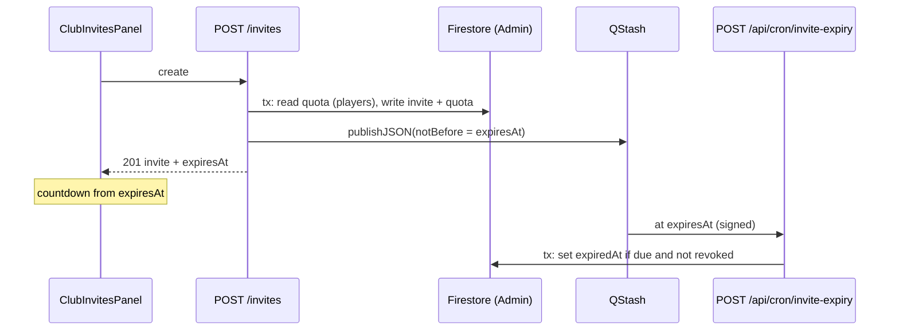

# Invite expiration and player invite limit

Every club invite code expires 12 hours after it is created. Players can create at most one invite per club every 11 hours. A delayed QStash message per invite marks it expired when the time is up. The UI tells users about the limit and shows how much time each code has left.

## Status

| Field | Value |
|-------|-------|
| Status | in-progress |
| Owner session | — |
| Last updated | 2026-09-30 |
| Related PR / branch | `cursor/invite-expiration-3c1e` (no PR yet) |

## Goals (v1)

- **12-hour expiry on every new invite.** The server sets `expiresAt = createdAt + 12h` and ignores any `expiresAt` the client sends. This applies to invites from players, club admins and super users.
- **Per-invite expiry job.** When an invite is created, the server publishes one delayed QStash message for that invite. At `expiresAt`, a signed cron route marks the invite expired (`expiredAt`) and writes an audit log entry. The read-time `expiresAt` checks stay the source of truth, so a late or missing QStash delivery never lets an expired code work.
- **Player limit: 1 invite per club per 11 hours.** The limit applies only to members whose club role is `player`. Club admins and super users are not limited. If an admin revokes a player's invite, that player can create a new one right away.
- **Clear messaging.** The invites panel explains both rules before anyone clicks. When a player is limited, the Create button is disabled and shows when they can create the next invite. A limited POST returns `429` with a readable message.
- **Remaining time on each code.** The admin active list, the "just created" card and the player's own-invite view all show a live countdown (for example "Expires in 11h 42m"). A code whose countdown reaches zero shows as expired without a reload.
- **Players see their own current invite.** Players with invite permission cannot list all invites. A new endpoint returns their own active invite and when they can create the next one, so the code survives a page reload.
- **Out of scope for v1:** backfilling existing invites (they keep `expiresAt: null` and stay non-expiring); expiry lengths configurable per club or per invite; deleting expired invite docs; showing expiry on the `/join` preview page; letting players revoke their own invites; merging the copies of the cron-auth helper across routes.

## Todos

1. [x] Add invite constants (`INVITE_TTL_MS = 12h`, `PLAYER_INVITE_COOLDOWN_MS = 11h`) and a pure `getInviteQuotaState` helper with unit tests.
2. [x] Server: have `createInvite` always set `expiresAt`. For `createdByRole === 'player'`, enforce the limit in a transaction using a quota doc (see Design). Add the `expiredAt` field to the type and to the invite mappers.
3. [x] Server: `POST /api/clubs/[clubId]/invites` stops reading `body.expiresAt`, maps the limit error to `429` with `nextAllowedAt`, and publishes the QStash expiry message after the write succeeds. A publish failure is logged and does not fail the request.
4. [x] Add `lib/services/inviteExpiryQueue.ts`, which wraps the `@upstash/qstash` `Client.publishJSON` call with `notBefore` and `deduplicationId`. It does nothing when `QSTASH_TOKEN` or `BASE_URL` is missing, or when emulators are on.
5. [x] Add the cron route `POST /api/cron/invite-expiry` with QStash signature or `CRON_SECRET` auth copied from `rsvp-schedule`. It marks one invite expired in an idempotent transaction and writes the audit entry `cron.invite_expired`.
6. [ ] Add `GET /api/clubs/[clubId]/invites/mine`, gated by `verifyCanCreateInvite`. It returns `{ invite | null, nextAllowedAt | null, limited }`. Add the matching `getMyClubInviteAPI` in `lib/api/client.ts`.
7. [ ] UI: add an `InviteExpiryCountdown` component. In `ClubInvitesPanel`, add the rules copy, the countdown on each row and on the created card, the disabled Create button with the next-allowed time for limited players, and the player's own-invite view.
8. [x] Firestore rules: deny all client access to `clubInviteQuotas` explicitly. The `clubInvites` rules stay unchanged.
9. [ ] Tests: route tests for 429, the ignored `expiresAt`, a publish failure that still returns 201, and cron auth plus idempotency. Service tests for the quota transaction and for revoke freeing the slot. Panel tests for the countdown, the disabled state and a club change clearing the player view.
10. [ ] Docs: `.env.sample` notes (the QStash vars now also publish messages), a short runbook section in this plan, and a README or `qstash-*` cross-link if needed.

## Current state

| Area | Today |
|------|-------|
| Type | [`ClubInvite`](../../types/club.ts) already has `expiresAt: Date \| null`, `revokedAt` and `maxUses`. It has no `expiredAt`. |
| Create | [`POST /api/clubs/[clubId]/invites`](../../app/api/clubs/[clubId]/invites/route.ts) accepts an optional `body.expiresAt` from the client. The UI never sends one, so every invite has `expiresAt: null` and never expires. It has no rate limit. |
| Create service | [`createInvite`](../../lib/services/clubService.ts) generates a 6-character code, checks for clashes with a `where('code')` query outside any transaction, then calls `ref.set`. |
| Read-time expiry | `listActiveInvitesForClub`, `findActiveInviteByCode` and the `redeemInvite` transaction already skip invites whose `expiresAt` has passed. Preview and redeem return `Invalid or expired invite code`. |
| Permissions | [`verifyCanCreateInvite`](../../lib/api/auth.ts) returns `createdByRole` (`super_user`, `club_admin`, or `player` when `settings.allowPlayerInvites` is on). List and revoke use `verifyClubAdmin`, so only admins can revoke. |
| UI | [`ClubInvitesPanel`](../../components/club/ClubInvitesPanel.tsx) has a Create button, a "just created" card (lost on reload) and an admin-only active list showing uses. It shows no expiry or limit. It already guards the list with a generation counter and a `clubIdRef`. |
| Cron / QStash | Three QStash-triggered routes ([`rsvp-schedule`](../../app/api/cron/rsvp-schedule/route.ts), `materialize-schedules`, `audit-retention`) each copy the same `authorizeCronRequest` helper (a `Receiver` signature check or `CRON_SECRET`). Nothing in the app publishes QStash messages yet; schedules are created by `scripts/setup-qstash-*.mjs`. `@upstash/qstash` ^2.9 is installed. |
| Rules | `clubInvites`: club admins can read; clients cannot write. |

## Design

### Data model

`clubInvites/{inviteId}` (existing collection, new fields):

| Field | Type | Notes |
|-------|------|-------|
| `expiresAt` | Timestamp | Now always `createdAt + 12h` for new invites. Legacy docs keep `null`. |
| `expiredAt` | Timestamp \| null | Set by the expiry cron. Informational only; reads still decide from `expiresAt`. |
| `expiryMessageId` | string \| null | QStash message id, for debugging. `null` if publishing was skipped or failed. |

`clubInviteQuotas/{clubId}_{uid}` (new; Admin SDK only):

| Field | Type | Notes |
|-------|------|-------|
| `clubId` | string | |
| `userId` | string | |
| `lastInviteId` | string | The player's most recent invite in this club. |
| `lastCreatedAt` | Timestamp | |

Because the quota doc is addressed by a deterministic id, the check is a single `tx.get`. There is no `createdBy + createdAt` compound query, so **no new composite index** is needed.

### Quota check (players only)

The check runs inside `createInvite` in one `runTransaction`, only when `createdByRole === 'player'`:

1. `tx.get(quotaRef)`. If the doc is missing, the player is allowed.
2. If `now - lastCreatedAt >= 11h`, the player is allowed.
3. Otherwise `tx.get(clubInvites/{lastInviteId})`. If that invite is missing or has `revokedAt` set, the player is allowed; this is how a revoke frees the slot.
4. Otherwise the transaction returns `{ ok: false, nextAllowedAt: lastCreatedAt + 11h }`.
5. When allowed, `tx.set(inviteRef, …)` and `tx.set(quotaRef, { lastInviteId, lastCreatedAt: now })` in the same transaction.

The transaction **returns** its outcome and sets no outer variables (see `AGENT_CONTEXT.md`, transactions can retry). Concurrent double-clicks retry the transaction and the second one is limited. Admins and super users skip the quota doc entirely.

A pure helper `getInviteQuotaState({ lastCreatedAt, lastInviteRevoked, now })` returns `{ limited, nextAllowedAt }`. Both the transaction and `GET …/invites/mine` use it, so the two can't drift.

The 11-hour limit and the 12-hour expiry are intentionally different: a player can create the next code an hour before the current one dies, so there is no gap with no working code. Their old code keeps working until it expires.

### API

| Route | Auth | Behavior |
|-------|------|----------|
| `POST /api/clubs/[clubId]/invites` | `verifyCanCreateInvite` (unchanged) | Ignores `body.expiresAt`; still accepts `maxUses`. On limit it returns `429 { error: 'You can create one invite every 11 hours.', nextAllowedAt }` with a fixed, client-safe message. On success it returns `201 { invite, link }` with `expiresAt` set, then publishes the expiry message. |
| `GET /api/clubs/[clubId]/invites/mine` | `verifyCanCreateInvite` | Returns `{ success, invite: (ClubInvite & { link }) \| null, nextAllowedAt: string \| null, limited: boolean }`. For admins and super users, `limited` is always `false` and `invite` is their latest invite (or `null`, since admins have no quota doc; the panel uses the full list for them). |
| `GET /api/clubs/[clubId]/invites` | `verifyClubAdmin` (unchanged) | Response already includes `expiresAt`; no change beyond the mapper adding `expiredAt`. |
| `POST /api/cron/invite-expiry` | QStash signature or `CRON_SECRET` | Body `{ inviteId }`. In a transaction: if the doc is missing, already revoked, already has `expiredAt`, or `expiresAt` is null or still in the future, it changes nothing and returns `200 { ok: true, changed: false }`. Otherwise it sets `expiredAt: now` and writes `auditLog({ action: 'cron.invite_expired', source: 'cron', … })`. Returns `401` if not authorized. Errors go through `sanitizeErrorForClient`. |

The early "future `expiresAt`" check guards against QStash delivering early or a replayed message. QStash retries on non-2xx responses, so the handler must be idempotent.

### QStash publish

`lib/services/inviteExpiryQueue.ts`:

```ts
scheduleInviteExpiry({ inviteId, expiresAt }): Promise<string | null>
```

- It uses `new Client({ token: QSTASH_TOKEN, baseUrl: QSTASH_API_URL ?? 'https://qstash-us-east-1.upstash.io' })`, the same region default as the setup scripts.
- It calls `publishJSON({ url: `${BASE_URL}/api/cron/invite-expiry`, body: { inviteId }, notBefore: Math.floor(expiresAt / 1000), deduplicationId: `invite-expiry-${inviteId}` })`.
- It returns `null` without calling QStash when `QSTASH_TOKEN` or `BASE_URL` is missing, or when `NEXT_PUBLIC_USE_FIREBASE_EMULATOR === 'true'`. Local development must never publish to production QStash, and QStash can't reach localhost anyway.
- After a successful publish, the route writes `expiryMessageId` with a best-effort update. Any error is caught and logged without the token.

Revoke does not cancel the message. The handler no-ops for revoked invites.

### UX

`ClubInvitesPanel` copy (under the "Invites" heading):

- Everyone: "Each invite expires 12 hours after it's created."
- Players (`!canManageInvites`): "You can create one invite every 11 hours."

States:

| State | UI |
|-------|----|
| Player, not limited | Create button enabled. |
| Player, limited | Create button disabled, labeled "Next invite in 3h 12m" (it counts down; when it hits zero the button enables without a reload). Their current code shows with Copy code, Copy link and "Expires in …". |
| Player, their code expired but still limited | Not possible, because the limit (11h) is shorter than the expiry (12h). |
| Admin | Create is always enabled. Each active-list row shows "Uses: n · Expires in 11h 42m". Legacy rows with a null `expiresAt` show "No expiration". |
| Countdown reaches zero | The row or card shows "Expired", its Copy buttons are disabled, and the admin list drops the row on the next refresh. |
| POST returns 429 (race or stale UI) | Show the server message and refetch `…/invites/mine` to sync `nextAllowedAt`. |

`InviteExpiryCountdown` takes `{ expiresAt: Date | string | null, now?: number }`. It uses one shared 30-second `setInterval` in the panel (a `now` state passed down), not one timer per row. The format is `Xh Ym` when at least 1 hour is left, `Ym` under an hour, and "Less than a minute" under 60 seconds. It needs `aria-live="polite"` on the created card only, so screen readers are not flooded by list rows.

Mobile: countdown text sits under the code in the existing `min-w-0` text block. Action buttons stay in the existing `flex-wrap` group. Check at 320px width.



## Critical decisions

- **Read-time `expiresAt` checks remain authoritative.** Do not remove the checks in `listActiveInvitesForClub`, `findActiveInviteByCode` or the `redeemInvite` transaction. The cron only records that an invite expired; it never grants or blocks access itself.
- **The server owns the TTL.** Never trust a client `expiresAt`. Drop the option from `createClubInviteAPI`.
- **A publish failure must not fail invite creation.** Once the invite is written, return `201` even if QStash is down.
- **Local work never publishes to QStash.** The emulator flag or a missing env var skips the publish.
- **Only players are limited, per club.** The quota key is `{clubId}_{uid}`. Do not add a global per-user limit.
- **Revoke frees the slot** through the `revokedAt` check on `lastInviteId`. Do not change the quota doc during revoke; that way revoke has no second write to keep consistent.
- **No new composite index.** If a later change queries `clubInvites` by `createdBy` + `createdAt`, it must add the index to `firestore.indexes.json` and deploy it to production (`AGENT_CONTEXT.md`).
- **Legacy invites are left alone.** `expiresAt: null` stays non-expiring. The UI must handle `null` ("No expiration") and must not crash on it.
- **Club change resets panel state.** The existing effect already clears `created`, `invites` and the busy flags. Add the new `myInvite` / `nextAllowedAt` state to that reset and to the generation guard.
- **Cron auth** copies the `authorizeCronRequest` pattern, with the endpoint URL built from `BASE_URL` for signature verification. Extracting a shared helper is out of scope.

## Files to touch

| Path | Change |
|------|--------|
| `lib/constants/invites.ts` (new) | `INVITE_TTL_MS`, `PLAYER_INVITE_COOLDOWN_MS`, limit message string |
| `lib/utils/inviteQuota.ts` (new) + `.test.ts` | Pure `getInviteQuotaState`, `formatInviteTimeRemaining` |
| [`types/club.ts`](../../types/club.ts) | Add `expiredAt: Date \| null` to `ClubInvite` |
| [`lib/services/clubService.ts`](../../lib/services/clubService.ts) | `createInvite`: always set TTL, quota transaction for players, return an `{ ok }` union or throw a typed limit error; mappers read `expiredAt`; new `getMyInviteState(clubId, uid, role)`; new `markInviteExpired(inviteId)` |
| [`lib/services/clubService.test.ts`](../../lib/services/clubService.test.ts) | Quota allowed/limited/revoked-frees-slot; admin skips quota; `markInviteExpired` idempotency |
| `lib/services/inviteExpiryQueue.ts` (new) + `.test.ts` | QStash publish wrapper with skip conditions |
| [`app/api/clubs/[clubId]/invites/route.ts`](../../app/api/clubs/[clubId]/invites/route.ts) + test | Ignore `body.expiresAt`, return 429, publish after write |
| `app/api/clubs/[clubId]/invites/mine/route.ts` (new) + test | Player own-invite state |
| `app/api/cron/invite-expiry/route.ts` (new) + test | Signed, idempotent expiry marker |
| [`lib/api/client.ts`](../../lib/api/client.ts) | Remove the `expiresAt` option from `createClubInviteAPI`; surface `nextAllowedAt` on 429; add `getMyClubInviteAPI` |
| `components/club/InviteExpiryCountdown.tsx` (new) | Countdown display |
| [`components/club/ClubInvitesPanel.tsx`](../../components/club/ClubInvitesPanel.tsx) + test | Rules copy, countdowns, limited state, player own-invite view |
| [`firestore.rules`](../../firestore.rules) | `match /clubInviteQuotas/{id} { allow read, write: if false; }` |
| [`.env.sample`](../../.env.sample) | Comment: `QSTASH_TOKEN` + `BASE_URL` also enable invite expiry messages |

## Acceptance criteria

- [ ] A new invite from any role has `expiresAt` exactly 12h after `createdAt`. A client-sent `expiresAt` is ignored.
- [ ] After `expiresAt`, preview and redeem return `Invalid or expired invite code`, and the admin list drops the invite, even if the cron never ran.
- [ ] With QStash configured, the cron route sets `expiredAt` and writes `cron.invite_expired` once. Repeat deliveries and early deliveries change nothing.
- [ ] The cron route returns 401 without a valid QStash signature or `CRON_SECRET`.
- [ ] A player's second invite in the same club within 11h returns 429 with `nextAllowedAt`. The same player in another club is allowed.
- [ ] After an admin revokes a player's invite, that player can create a new one immediately.
- [ ] Club admins and super users are never limited.
- [ ] A double-click on Create as a player produces exactly one invite.
- [ ] The panel shows the 12h rule to everyone and the 11h rule to players. A limited player sees a disabled button with a live "Next invite in …" label and their current code with its countdown, and still sees them after a reload.
- [ ] Every code in the admin list and the created card shows remaining time. Legacy codes show "No expiration".
- [ ] With emulators on, creating an invite makes no QStash call.
- [ ] Layout holds at 320px width. `yarn lint`, `yarn test:run` and `yarn build` pass.

## Rollout / runbook

1. Deploy with `QSTASH_TOKEN`, `QSTASH_CURRENT_SIGNING_KEY`, `QSTASH_NEXT_SIGNING_KEY` and `BASE_URL` set in Vercel production. The signing keys are already there for the existing cron routes; confirm `QSTASH_TOKEN` is present at runtime and not only in setup scripts.
2. Deploy the Firestore rules (`firebase deploy --only firestore:rules`) so `clubInviteQuotas` is explicitly locked. No index deploy is needed.
3. Smoke test: create an invite and confirm a scheduled message for `/api/cron/invite-expiry` appears in the QStash dashboard with the right delivery time.

## Handoff

> Updated by `/handoff`. `/feature-context` reads this first.

### Done so far

- `lib/constants/invites.ts` holds the TTL, cooldown and limit message. `lib/utils/inviteQuota.ts` holds `getInviteQuotaState` and `formatInviteTimeRemaining`, with tests.
- `createInvite` always sets `expiresAt = createdAt + 12h` and `expiredAt: null`. For players it reads and writes `clubInviteQuotas/{clubId}_{uid}` in one transaction and throws `InviteQuotaExceededError(nextAllowedAt)` when limited. It reads the last invite only when inside the cooldown, and a revoked or missing last invite frees the slot. The `expiresAt` input was removed.
- The invite mappers return `expiredAt`. It is **optional** on `ClubInvite` (`expiredAt?: Date | null`), not required as the Design says, because legacy docs lack it and a required field would churn unrelated test fixtures.
- The POST route ignores `body.expiresAt` and returns `429 { error, nextAllowedAt }`. `createClubInviteAPI` no longer takes `expiresAt`.
- `lib/services/inviteExpiryQueue.ts` provides `scheduleInviteExpiry`, which publishes to `${BASE_URL}/api/cron/invite-expiry` with `notBefore` and `deduplicationId: invite-expiry-{id}`. It returns null when emulators are on or when `QSTASH_TOKEN` or `BASE_URL` is missing.
- The POST route schedules expiry after the audit log and stores `expiryMessageId` through `recordInviteExpiryMessageId`. A failure is logged with the message only and still returns 201. New invites store `expiryMessageId: null`.
- `POST /api/cron/invite-expiry` (POST only; it needs a body) copies the `authorizeCronRequest` pattern and calls `markInviteExpired`. That transaction does nothing for a missing, revoked, already-marked, legacy or not-yet-due invite. The route audits `cron.invite_expired`, a new `AuditAction`, only when the invite changed.
- `firestore.rules` denies client access to `clubInviteQuotas`. `.env.sample` notes that `BASE_URL` plus `QSTASH_TOKEN` at runtime enable expiry messages.
- Tests: service (12h expiry, admin skips quota, player limited per club, revoke frees slot, elapsed cooldown, `markInviteExpired` idempotency), invites route (429, ignored `expiresAt`, message id recorded, publish failure still 201), cron route (401 with no auth or a bad signature, 400, audit only on change), queue (publish args, emulator and env skips). `yarn test:run` passes (460 tests). `tsc` shows the same 19 errors as `main`, none in touched code.

### Remaining work

- Todo 6: `GET /api/clubs/[clubId]/invites/mine` plus `getMyClubInviteAPI`. Share `getInviteQuotaState` with `createInvite` by reading `clubInviteQuotas/{clubId}_{uid}` and then `lastInviteId`.
- Todo 7: the UI. `lib/api/client.ts` still throws a plain `Error` on 429, so surface `nextAllowedAt` from it (for example an error subclass) before building the limited state.
- Todo 9 (panel tests) and todo 10 (docs cross-link and a rules deploy note).

### Blockers / risks

- **`QSTASH_TOKEN` at runtime.** Today the token is only needed by the setup scripts, so it may not be set in Vercel runtime env. Without it, expiry still works through the read-time checks, but no `expiredAt` or audit entry is written.
- **Signature URL mismatch.** Verification must use the `BASE_URL`-derived endpoint URL (see the `rsvp-schedule` comment), or every QStash delivery returns 401.
- **Code-clash check outside the transaction** is existing behavior. Keep it as-is; don't widen the transaction to include a query.

### Pointers for the next agent

- Start at: todo 6, a new `app/api/clubs/[clubId]/invites/mine/route.ts` plus a `getMyInviteState` helper in [`lib/services/clubService.ts`](../../lib/services/clubService.ts).
- Pre-existing Prettier drift in `clubService.ts`, `clubService.test.ts`, the invites `route.ts` and `lib/api/client.ts` is on `main` too; don't reformat whole files in this PR.
- Do not: remove the read-time `expiresAt` checks, trust a client `expiresAt`, publish to QStash when emulators are on, or add a `createdBy + createdAt` query without an index.
- Verify with: `yarn test:run` (service, route, panel tests); run locally against emulators and create invites as a player and as an admin; call the cron route with `Authorization: Bearer $CRON_SECRET` and an `inviteId` whose `expiresAt` is in the past.
