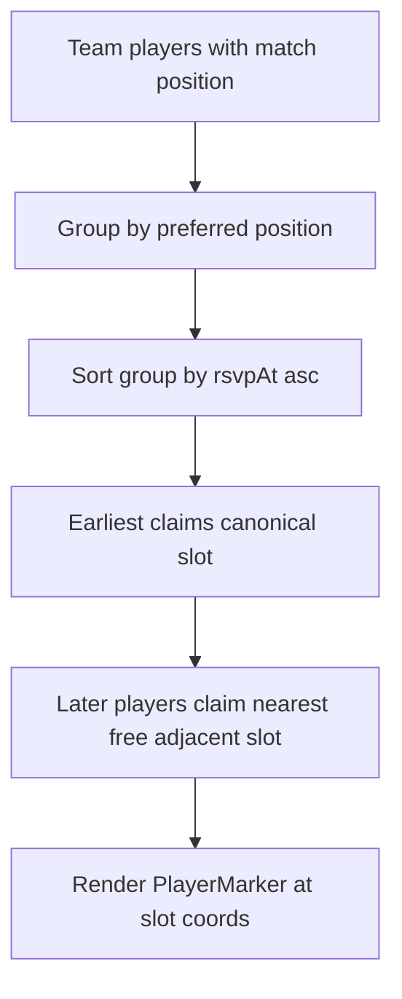

# Pitch Lineup Visualization

Plan to revive the paused soccer-pitch lineup UI on match team views, restyle player markers to fit the pitch like a pro lineups screen, resolve duplicate positions with RSVP timestamp priority, and let players update match positions with team-aware availability.

## Goals (v1)

- **Prerequisite:** Integrate LaunchDarkly feature flags (none exist in the repo today) and gate the pitch lineup behind a flag so list view remains the default until the pitch is ready to ship.
- Show each team on a soccer pitch using the player’s match position (RSVP snapshot, else profile).
- Teams 1 and 2 share one mirrored dual-team pitch; team 3+ use separate pitches.
- When multiple players on the same team share a preferred position, assign display slots by earliest `rsvpAt` (canonical slot first; later players take nearest free adjacent roles). Do **not** rewrite stored `RSVP.position`.
- Let players pick/update position for a match from team-aware options (occupancy cues; collisions still allowed and handled by the layout resolver).
- Player icons and names must fit the pitch densely, matching the reference lineups screenshot style.

## Todos

1. Prerequisite: LaunchDarkly SDK + provider + env; create `pitch-lineup-view` flag (default off)
2. Slot-assignment util (replace horizontal-only offsets); unit tests for duplicates + `rsvpAt` order
3. Restyle pitch surface / markings / `PlayerMarker` to screenshot density
4. Dual-team pitch for teams 1–2; per-team / toggle for 3+
5. Re-mount pitch in `TeamsDisplay` behind the LD flag (Pitch / List toggle when flag on)
6. Team-aware position picker occupancy UI (RSVP confirm + post-RSVP edit)
7. Update `IMPLEMENTATION_PLAN.md` pitch section; document flag in `.env.sample` / SETUP

## Prerequisite: LaunchDarkly feature flags

There is **no** feature-flag system in the codebase today (no LaunchDarkly packages, no `FEATURE_*` helpers, no provider). Pitch was previously removed by deleting the mount point, not by a flag. Before shipping pitch UI again, add LaunchDarkly as a project-wide primitive and use it for this feature.

### Why

- Roll pitch out gradually (internal / percentage / user targeting) without another hard disconnect.
- Keep list view (admin DnD, check-in icons, cancel RSVP) as the safe default when the flag is off.
- Establish one flag pattern for later features.

### SDK and wiring

| Piece | Choice |
|-------|--------|
| Client SDK | `@launchdarkly/react-client-sdk` |
| Server SDK | `@launchdarkly/node-server-sdk` only if an API/route needs the same gate (not required for v1 pitch mount) |
| Provider | Client wrapper under `AuthProvider` in [`app/layout.tsx`](../../app/layout.tsx) so flags can use Firebase `uid` / email as LD context |
| Hook | Thin app helper, e.g. `lib/flags/useFeatureFlag.ts` → `useFlags()` / `useLDClient()`, with a typed flag key union |
| Fail-closed | If client key missing or LD errors, treat unknown flags as **false** (list view only) |

**Env (document in [`.env.sample`](../../.env.sample) and SETUP/DEPLOYMENT):**

```bash
# LaunchDarkly (client)
NEXT_PUBLIC_LAUNCHDARKLY_CLIENT_ID=

# Optional: server evaluation later
# LAUNCHDARKLY_SDK_KEY=
```

Local/dev: use an LD test environment client ID, or leave unset so all flags evaluate false.

### Flag for this feature

| Key | Type | Default | Behavior |
|-----|------|---------|----------|
| `pitch-lineup-view` | boolean | `false` | When `true`, match teams UI may show Pitch view (and Pitch/List toggle). When `false`, keep current card list only (`TeamsDisplay` as today). |

Create the flag in the LaunchDarkly dashboard (dev + prod projects/environments) before relying on it in CI or production. Targeting can start with admins or a test cohort.

### Integration sketch

```tsx
// TeamsDisplay (conceptual)
const showPitch = useFeatureFlag('pitch-lineup-view')

// flag off → list cards only (current behavior)
// flag on  → Pitch / List toggle; default Pitch for players, List still available for admin DnD
```

Provider context key users by `user.uid` when authenticated; anonymous/boot context until auth resolves. Do not block first paint forever on LD — render list until flags are ready if needed.

### Out of scope for the LD prerequisite

- Migrating other features onto flags
- LD Experimentation / metrics
- Server-side flag middleware for every route

## Current state

### Dead pitch stack (left in-tree, not mounted)

Removed from [`TeamsDisplay`](../../components/teams/TeamsDisplay.tsx) in commit `a108877` (“Drag and drop for admins”). Components remain:

| Path | Role |
|------|------|
| [`components/teams/SoccerPitch.tsx`](../../components/teams/SoccerPitch.tsx) | Mobile toggle vs stacked pitches |
| [`components/teams/SinglePitchView.tsx`](../../components/teams/SinglePitchView.tsx) | One pitch + absolute markers |
| [`components/teams/PitchSurface.tsx`](../../components/teams/PitchSurface.tsx) | Field surface wrapper |
| [`components/teams/PitchMarkings.tsx`](../../components/teams/PitchMarkings.tsx) | FIFA-style SVG lines |
| [`components/teams/PlayerMarker.tsx`](../../components/teams/PlayerMarker.tsx) | Jersey circle + name + position code |
| [`components/teams/TeamToggle.tsx`](../../components/teams/TeamToggle.tsx) | Mobile team switcher |
| [`lib/utils/pitchLayout.ts`](../../lib/utils/pitchLayout.ts) | Position → `%` coords + horizontal offsets |
| [`lib/utils/displayName.ts`](../../lib/utils/displayName.ts) | `formatPitchDisplayName` |

Reuse this stack; restyle markers/surface. Do **not** revive the ancient `origin/player-positions` branch (coarse defender/midfielder/forward prototype).

### Live position / RSVP path (keep)

- Profile default: [`User.position`](../../types/user.ts); catalog in [`lib/constants/positions.ts`](../../lib/constants/positions.ts)
- Per-match snapshot: [`RSVP.position`](../../types/rsvp.ts) + `rsvpAt`; confirm/PATCH via [`app/api/rsvp/route.ts`](../../app/api/rsvp/route.ts)
- UI: [`RSVPPositionModal`](../../components/matches/RSVPPositionModal.tsx), edit in [`MatchDetails`](../../components/matches/MatchDetails.tsx)
- Display merge already in [`MatchDetailView`](../../components/matches/MatchDetailView.tsx): `rsvp.position ?? user.position`

### Live teams UI (stays as fallback)

[`TeamsDisplay`](../../components/teams/TeamsDisplay.tsx) → [`DroppableTeamCard`](../../components/teams/DroppableTeamCard.tsx): cards, check-in, admin DnD. Remains the only view when `pitch-lineup-view` is off, and remains available via List when the flag is on.

## Placement algorithm

**Display-only** slot assignment (does not mutate RSVP or profile positions).

1. Input: team `playerIds`, users with match position, RSVPs for `rsvpAt`.
2. Group players by preferred position code (`user.position` after match merge); missing → `CM`.
3. Sort each group by `rsvpAt` ascending (earliest first). Players without RSVP sort last.
4. Earliest player claims the canonical coordinate from `POSITION_COORDINATES`.
5. Later duplicates claim the nearest **free** adjacent role slot (adjacency map below). If all adjacent slots are taken, fall back to a small horizontal nudge on the last claimed related slot (escape hatch only).
6. Render `PlayerMarker` at assigned `%` coords.



### Adjacency (overflow targets, in order)

Document and implement as a constant next to `POSITION_COORDINATES`:

| Preferred | Try next |
|-----------|----------|
| GK | CDM, CB, CM |
| LB | LWB, CB, LM, CDM |
| RB | RWB, CB, RM, CDM |
| CB | LB, RB, CDM, CM |
| LWB | LB, LM, LW, CDM |
| RWB | RB, RM, RW, CDM |
| CDM | CM, CB, CAM |
| CM | CDM, CAM, LM, RM |
| CAM | CM, CF, ST, CDM |
| LM | LW, LWB, CM, CAM |
| RM | RW, RWB, CM, CAM |
| LW | LM, CF, ST, LWB |
| RW | RM, CF, ST, RWB |
| CF | ST, CAM, LW, RW |
| ST | CF, CAM, LW, RW |

**Why not persist reassignment:** Changing stored position on collision would surprise players, fight the position picker, and can trigger GK swap side effects (`placeGkOnTeamWithoutGk` / `swapGkWithLowerTeam`). Layout-only resolution matches the simpler requirement path.

## Layout / UI

### Pitch composition

- **Teams 1–2:** One dual-team pitch (reference screenshot). Team 1 top half attacking down; team 2 bottom half attacking up (`flipY` / counter-flip labels as in existing `PlayerMarker`).
- **Team 3+:** Separate pitches; mobile may keep `TeamToggle`.
- Field look: dark purple surface + light lavender markings (tokenized CSS variables), not the old bright green as the end state.
- List view retained for admin DnD, check-in legend, cancel RSVP.

### Player markers (screenshot fit)

- Compact circular headshot or grey silhouette when no photo.
- Jersey number + truncated name under/ beside the icon (reuse `formatPitchDisplayName` / jersey helpers).
- Goalkeepers visually distinct (kit/color), not oversized.
- Mobile sizes must keep ~11 markers readable without overlapping labels; prefer smaller markers over clipping names.
- No requirement for captain / card / sub badges from pro apps.

### Position picker (team-aware)

Surfaces: RSVP confirm modal + post-RSVP edit while RSVP window allows edits.

- List `SOCCER_POSITIONS` with per-**team** occupancy when the user is already on a team (e.g. `CB · 2 claimed`), derived from that team’s roster + match positions.
- Before teams exist, show catalog without occupancy (or match-wide counts only if cheap).
- Selecting a taken position remains allowed; layout resolver handles collisions.
- Persist only via existing confirm / `updateRSVPPosition` APIs. GK rules unchanged.

## Non-goals (v1)

- Formation picker UI (4-4-2 style)
- Pitch-surface drag-and-drop (admin keeps list DnD)
- Persisting auto-reassigned positions
- Captain / yellow card / substitution overlay icons
- Rewriting team generation to be formation-slot based

## Implementation notes for coding agents

1. Land LaunchDarkly prerequisite first; ship pitch UI behind `pitch-lineup-view`.
2. Extend/replace `getOffsetPosition` usage with the slot resolver; pass `matchRSVPs` into pitch layout for `rsvpAt`.
3. Prefer adapting dead components over rewriting from scratch; replace marker visuals to match the screenshot.
4. Wire `usersWithMatchPosition` already prepared in `MatchDetailView`.
5. Tests: slot resolver unit tests; component smoke for flag off/on; manual mobile density check vs reference screenshot.

## Related docs

- [`docs/CONTEXT_PROMPT.md`](../CONTEXT_PROMPT.md)
- [`docs/IMPLEMENTATION_PLAN.md`](../IMPLEMENTATION_PLAN.md) (pitch section still describes primary view — update when implementing)
- [`docs/features/rsvp-concurrency-plan.md`](rsvp-concurrency-plan.md) (RSVP / team expand context)
- [`docs/features/check-in-feature-plan.md`](check-in-feature-plan.md) (list-view check-in UI that must keep working)
