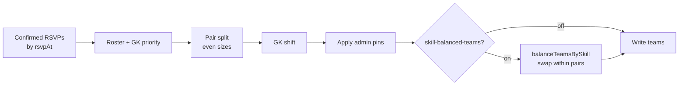

# Player Skill Rating + Skill-Balanced Teams

Plan to add a private, club-scoped skill rating per player (self-rated, with an optional club-admin override) and make the existing **Rebalance teams** action use those ratings so matchups are even in strength, not just in size.

## Status

| Field | Value |
|-------|-------|
| Status | planned |
| Owner session | — |
| Last updated | 2026-11-05 |
| Related PR / branch | `orkun/confident-franklin-t55hwy` (plan only) |

## Goals (v1)

- **Self-rating** — each player rates themselves **1–5** per club, with plain-language anchors (see [Rating scale](#rating-scale)). Prompted once when they first RSVP in a club, editable from the profile page.
- **Admin override** — club admins can set a rating for any member of their club. The admin rating wins over the self-rating when present. This corrects the usual self-rating bias (new players overrate, strong players underrate).
- **Private ratings** — players see only their own self-rating. Nobody sees anyone else's rating except club admins (and super users). Ratings never show up on match pages, rosters, or team cards.
- **Skill-aware rebalance** — when the flag is on, **Rebalance teams** keeps everything it does today (RSVP-order roster selection, even pair sizes, one GK per team when available, admin pins) and then swaps outfield players within each matchup pair (Team 1 vs 2, 3 vs 4, …) to minimize the difference in total rating.
- **Feedback** — after a skill rebalance, show the admin a short summary: per-team strength totals and how many players were unrated (defaulted).
- **Feature flag** — everything ships behind a new LaunchDarkly flag `skill-balanced-teams` (default off).
- **Out of scope for v1:**
  - Peer rating / voting on teammates.
  - Ratings learned from match results (Elo / TrueSkill). Needs score capture first; see [Later](#later).
  - Position-aware balancing (spreading defenders/attackers). v1 balances total rating only; GK rule stays as-is.
  - Changing the auto-generation that runs on every RSVP (`expandTeamsForMatch`). Auto-generation stays RSVP-order; skill balance only runs when an admin presses Rebalance.
  - Showing ratings or strength numbers to players.
  - A global (cross-club) rating.

## Todos

1. Add `skill-balanced-teams` to [`lib/flags/featureFlags.ts`](../../lib/flags/featureFlags.ts) (keys, defaults, `NEXT_PUBLIC_FF_SKILL_BALANCED_TEAMS` override) + `.env.sample`; create the flag in LD (off).
2. Types: `types/playerRating.ts` (`PlayerRating`, `PlayerRatingFirestore`, `SkillRating = 1 | 2 | 3 | 4 | 5`, `isSkillRating()` guard, `effectiveRating()` helper).
3. Firestore: new `playerRatings` collection + rules (own doc readable, club admin readable, all writes API-only). Validate with the emulator.
4. API: `GET/PUT /api/clubs/[clubId]/ratings/me` (self) and `GET /api/clubs/[clubId]/ratings` + `PUT /api/clubs/[clubId]/ratings/[userId]` (club admin). Zod-validate, `verifyAuth` / membership / `verifyClubAdmin`, `sanitizeErrorForClient`, audit log on admin writes.
5. Pure balancer: `lib/teams/balanceTeamsBySkill.ts` + colocated tests (see [Algorithm](#algorithm)).
6. Wire balancer into [`app/api/teams/rebalance/route.ts`](../../app/api/teams/rebalance/route.ts) as the last step before writing teams, gated server-side by `evaluateFeatureFlag('skill-balanced-teams', …)`. Return `strength` summary in the response.
7. UI — self-rating: `SkillRatingPicker` component; prompt in the RSVP confirm flow when the player has no rating for this club; edit row on [`app/profile/page.tsx`](../../app/profile/page.tsx) per club.
8. UI — admin: rating column / inline picker in the club member roster ([`components/admin/ClubAdminPanel.tsx`](../../components/admin/ClubAdminPanel.tsx)) showing self vs admin rating.
9. UI — rebalance feedback: [`components/admin/RebalanceTeamsButton.tsx`](../../components/admin/RebalanceTeamsButton.tsx) shows "Balanced by skill · Team 1: 31 · Team 2: 30 · 3 unrated" after success (flag on); label stays "Rebalance teams".
10. Docs: update [`docs/ARCHITECTURE.md`](../ARCHITECTURE.md) (new collection + routes), README/SETUP flag list.

## Current state

- **Rebalance today balances size, not strength.** [`app/api/teams/rebalance/route.ts`](../../app/api/teams/rebalance/route.ts) (club-admin only via `verifyClubAdminForMatch`):
  1. Loads confirmed RSVPs, dedupes, sorts by `rsvpAt`.
  2. Takes the first `sum(maxSize)` players as the roster; pulls in early GKs, bumping the latest non-GK.
  3. Splits the roster into matchup pairs (1&2, 3&4, …) as contiguous RSVP slices, even sizes via `computeTargetSizes`.
  4. `shiftGoalkeepersOntoTeamsWithoutGk` gives each team a GK where possible.
  5. `applyPersistedTransfersKeepingBalance` re-applies admin pins (`matches/{id}.manualTeamAssignments`) and restores pair sizes.
  6. Batch-writes `playerIds` on each team doc; audit `team.rebalanced`.
- **Button:** [`components/admin/RebalanceTeamsButton.tsx`](../../components/admin/RebalanceTeamsButton.tsx), rendered in [`components/matches/MatchDetailView.tsx`](../../components/matches/MatchDetailView.tsx) when `canManageMatch && teams.length >= 2`. Calls `rebalanceTeamsAPI` in [`lib/api/client.ts`](../../lib/api/client.ts).
- **Undo path exists:** [`components/admin/RestoreRsvpOrderButton.tsx`](../../components/admin/RestoreRsvpOrderButton.tsx) → `/api/teams/generate` with `restoreRsvpOrder: true` (pins only, ignores current skew). This is also the undo for a skill rebalance.
- **Auto-generation on RSVP:** [`lib/teams/expandTeamsForMatch.ts`](../../lib/teams/expandTeamsForMatch.ts) (called from [`app/api/rsvp/route.ts`](../../app/api/rsvp/route.ts)) appends new players to existing teams via `assignUnassignedPlayersToTeams` without reshuffling. A plain force-regenerate merges current-vs-baseline diffs as implied transfers, so a skill-balanced roster survives it. New RSVPs after a rebalance do erode balance; admin re-presses Rebalance.
- **Team logic:** [`lib/utils/teamGenerator.ts`](../../lib/utils/teamGenerator.ts) (`isGoalkeeper`, GK shift, pins, `enforceTeamMaxSizes`). Well covered by `teamGenerator.test.ts`.
- **No rating data anywhere.** `User` ([`types/user.ts`](../../types/user.ts)) and `ClubMembership` ([`types/club.ts`](../../types/club.ts)) have no skill field.
- **Privacy constraint:** `users/{uid}` is readable by **any signed-in user** and `clubMemberships` by any club member ([`firestore.rules`](../../firestore.rules)). Ratings must not live on either doc.
- **Flags:** client `useFeatureFlag`, server `evaluateFeatureFlag` ([`lib/flags/evaluateFeatureFlag.ts`](../../lib/flags/evaluateFeatureFlag.ts), node SDK, fail-closed).

## Design

### Rating scale

**1–5 integers**, not 1–10. People can't self-assess at 10-point precision, and with ≤11 players per side a 5-point scale already gives the balancer enough room. Anchors shown in the picker:

| Value | Label | Hint |
|-------|-------|------|
| 1 | Beginner | New to soccer or haven't played in years |
| 2 | Casual | Play occasionally, still learning the basics |
| 3 | Solid | Comfortable on the ball, regular pickup player |
| 4 | Strong | Played organized / high-school / league soccer |
| 5 | Elite | Played college, semi-pro, or above |

The balancer works on numbers, so the scale can later move to half-steps or a learned rating without changing the algorithm.

### Effective rating

```
effective = adminRating ?? selfRating ?? DEFAULT_RATING (3)
```

Unrated players default to 3 (the midpoint). The rebalance response reports how many were defaulted so the admin knows how much to trust the result.

### Data model

New top-level collection `playerRatings`, doc id `${clubId}_${userId}` (same pattern as `clubMemberships`).

| Field | Type | Notes |
|-------|------|-------|
| `clubId` | string | tenant key |
| `userId` | string | |
| `selfRating` | 1–5 \| null | written only via `PUT …/ratings/me` |
| `selfRatedAt` | Timestamp \| null | |
| `adminRating` | 1–5 \| null | written only by club admin route; `null` clears override |
| `adminRatedBy` | string \| null | admin uid |
| `adminRatedAt` | Timestamp \| null | |
| `updatedAt` | Timestamp | |

Why a separate collection and not `clubMemberships` / `users`: both are broadly readable today, and loosening or splitting those rules is riskier than a new, tightly-ruled collection.

**Rules (sketch):**

```
match /playerRatings/{ratingId} {
  allow read: if isSignedIn() &&
    (resource.data.userId == request.auth.uid || isClubAdmin(resource.data.clubId));
  allow write: if false; // API / Admin SDK only
}
```

Note that the owner can read their own doc, which includes `adminRating`. If we want the override hidden from the player (recommended, see decisions), the client never reads the collection directly: all reads go through the API, which strips `adminRating` for non-admins. In that case tighten rules to `allow read: if isClubAdmin(resource.data.clubId);`.

**Indexes:** reads are by doc id (self, per user) or `where('clubId','==',…)` (admin roster, equality only) → no composite index needed. The rebalance route reads by doc id (`getAll` on `${clubId}_${uid}` refs) for the match's players.

### API

| Route | Auth | Behavior |
|-------|------|----------|
| `GET /api/clubs/[clubId]/ratings/me` | `verifyAuth` + active membership | `{ selfRating }` (never `adminRating`) |
| `PUT /api/clubs/[clubId]/ratings/me` | `verifyAuth` + active membership | body `{ selfRating: 1–5 }`; upsert, merge |
| `GET /api/clubs/[clubId]/ratings` | `verifyClubAdmin` | `[{ userId, selfRating, adminRating, effective }]` for active members |
| `PUT /api/clubs/[clubId]/ratings/[userId]` | `verifyClubAdmin`; target must be an active member | body `{ adminRating: 1–5 \| null }`; audit `player.rating_set` (no rating value in audit metadata beyond what admins can already see) |

Membership fetch failures → retryable 500/503, never "not a member" (AGENT_CONTEXT safety #15). Errors through `sanitizeErrorForClient`.

`POST /api/teams/rebalance` response gains (flag on only):

```ts
strength?: {
  teams: Array<{ teamNumber: number; total: number; average: number }>
  unratedCount: number
}
```

### Algorithm

New pure module `lib/teams/balanceTeamsBySkill.ts`:

```ts
balanceTeamsBySkill(
  teams: TeamAssignment[],          // output of applyPersistedTransfersKeepingBalance
  ratingByUserId: Map<string, number>,
  locked: Set<string>               // pinned players + goalkeepers
): TeamAssignment[]
```

Run it **last**, after the existing GK shift and pin application, and make it **swap-only within each matchup pair**:

1. Group teams into pairs by `teamNumber` (1&2, 3&4, …). An unpaired last team is left alone.
2. In each pair, the *movable pool* = non-locked players on both teams. Each team keeps exactly its current number of movable slots, so sizes, GK coverage, and pins are unchanged by construction.
3. Seed: sort the pool by rating desc (tie-break `rsvpAt` asc for determinism), then assign each player to the team with the lower running total that still has a free movable slot (locked players' ratings count toward the starting totals).
4. Improve: repeat pairwise swaps (one movable player from each side) that strictly reduce `|totalA − totalB|` until none does. Pool is ≤ 22, so O(n²) per pass is trivial.
5. Tie-break among equally good swaps: prefer the one that also reduces the gap in count of top-rated (≥ 4) players, so one team doesn't get all the 5s balanced by a pile of 1s.

Why swap-only at the end instead of rewriting the split: the existing pipeline already encodes RSVP fairness (who plays), GK priority, pins, and max sizes, all with tests. A size-neutral swap layer can't break any of them, and the balancer stays small and testable on its own.

Pair membership (which players are in the 1&2 game vs the 3&4 game) stays RSVP-ordered. Balancing across pairs is out of scope; pairs are separate games.



### UX

- **RSVP prompt:** first RSVP in a club with no `selfRating` → a short step in the RSVP confirm dialog: "How would you rate your level? Only club admins see this." Skippable ("Skip for now"); skipping must not block the RSVP.
- **Profile:** "Skill level" row per club membership with the same picker.
- **Admin roster:** column showing `self` and `admin` values; admin picks a value or "Use player's rating" (clears override). Must wrap at 320px (AGENT_CONTEXT narrow-row rule).
- **Rebalance feedback:** inline line under the button after success; nothing changes for players.
- Picker: shadcn `RadioGroup` or segmented buttons with label + hint; RHF + Zod if it lives in a form.

## Critical decisions

- **Hide ratings from everyone but the player (own self-rating) and club admins.** Visible ratings in pickup groups cause friction and push people to inflate their self-rating. Recommendation: also hide the admin override from the player (reads go through API only). Needs product confirmation.
- **Club-scoped, not global.** A "4" in a casual Sunday group isn't a "4" in a competitive league, and admin overrides belong to a club anyway. Cost: a player in two clubs rates twice (rare).
- **RSVP order still decides who plays.** Ratings only decide which team you're on. Skill must never bump someone off the roster.
- **Do not touch auto-generation.** `expandTeamsForMatch` stays RSVP-order. Skill balancing is an explicit admin action. Do not write skill-driven moves into `manualTeamAssignments` (that would turn them into permanent pins and break Restore RSVP order).
- **Server-side flag check.** The rebalance route evaluates `skill-balanced-teams` itself; don't trust a client `mode` param alone.
- **Trusted logic on server.** All rating writes and the balancer run in API routes / `lib/` (AGENT_CONTEXT).
- **Async UI rules apply:** club-scoped rating fetches must ignore stale responses after the club changes; a failed post-save refresh must not roll back a saved rating.

## Files to touch

| Path | Change |
|------|--------|
| `lib/flags/featureFlags.ts` (+ test) | add `skill-balanced-teams` key, default, local override |
| `.env.sample` | `NEXT_PUBLIC_FF_SKILL_BALANCED_TEAMS` |
| `types/playerRating.ts` (new) | types, guard, `effectiveRating`, `DEFAULT_RATING` |
| `firestore.rules` | `playerRatings` rules |
| `app/api/clubs/[clubId]/ratings/route.ts` (new, + test) | admin list |
| `app/api/clubs/[clubId]/ratings/me/route.ts` (new, + test) | self get/put |
| `app/api/clubs/[clubId]/ratings/[userId]/route.ts` (new, + test) | admin put |
| `lib/ratings/getRatingsForUsersAdmin.ts` (new) | batched `getAll` by doc id for rebalance |
| `lib/teams/balanceTeamsBySkill.ts` (new, + test) | pure balancer |
| `app/api/teams/rebalance/route.ts` (+ test) | flag check, load ratings, call balancer, `strength` in response |
| `lib/api/client.ts` | rating API helpers; `rebalanceTeamsAPI` return type |
| `types/auditLog.ts` | `player.rating_set` action |
| `components/ratings/SkillRatingPicker.tsx` (new, + test) | picker |
| RSVP confirm flow (locate the RSVP dialog component) | optional rating step |
| `app/profile/page.tsx` | per-club skill row |
| `components/admin/ClubAdminPanel.tsx` (+ test) | roster rating column |
| `components/admin/RebalanceTeamsButton.tsx` (+ test) | strength summary |
| `docs/ARCHITECTURE.md` | collection + routes |

## Acceptance criteria

- [ ] Flag off: rebalance output is byte-for-byte what it is today (existing `route.test.ts` passes unchanged); no rating UI visible.
- [ ] Player can set/change their 1–5 rating per club from the RSVP flow (skippable) and profile.
- [ ] Club admin can view self + admin ratings for their club's members and set/clear an override; non-admins get 403; other clubs' ratings are unreachable.
- [ ] A signed-in non-admin cannot read another player's rating via client Firestore (rules test in emulator) or API.
- [ ] Flag on: rebalance keeps sizes, roster membership, GK-per-team, and pins identical to the flag-off run, and only the outfield split within each pair changes.
- [ ] Unit tests: balancer reaches the optimal total gap on small hand-built cases (e.g. ratings `[5,5,4,3,2,1]` → 10 vs 10); locked players never move; odd team untouched; deterministic output for equal ratings; all-unrated input is a no-op relative to input order.
- [ ] Rebalance response includes per-team totals and `unratedCount`; button shows them.
- [ ] Restore RSVP order still returns the pre-skill RSVP split (pins only).
- [ ] UI works at 320px; `yarn lint`, `yarn test:run`, `yarn build` pass.

## Later

- **Results-based ratings:** record final score per matchup, then run Elo/TrueSkill per club and blend with self/admin rating (e.g. learned rating takes over after N matches). This is the long-term answer to self-rating bias.
- **Peer input:** lightweight post-match "who stood out" votes feeding the learned rating.
- **Position-aware balance:** add a secondary objective that spreads DEF/MID/FWD across the pair.
- **Auto skill-balance at RSVP close** (e.g. QStash job when the RSVP poll closes) instead of a manual press.
- **Cross-pair balancing** when teams 3/4 are subs rotating into the same game.

## Handoff

> Updated by `/handoff`. `/feature-context` reads this first.

### Done so far

- Plan written. No code changes.

### Remaining work

- Get product sign-off on the open decisions below, then start at Todo 1 (flag) and Todo 5 (pure balancer + tests). Those two are independent and can ship first, since the balancer is a no-op until wired in.

### Open decisions (confirm with owner)

- 1–5 scale with the anchors above? (Recommended.)
- Hide the admin override from the player? (Recommended: yes.)
- Prompt during first RSVP, or only on profile? (Recommended: RSVP, skippable.)

### Blockers / risks

- Self-ratings will be noisy until admins override. Mitigation is the admin column plus the `unratedCount` feedback.
- New RSVPs after a rebalance erode balance (appended without reshuffle). Accepted for v1.

### Pointers for the next agent

- Start at: `lib/teams/balanceTeamsBySkill.ts` + test, then `app/api/teams/rebalance/route.ts`.
- Do not: store ratings on `users` or `clubMemberships` (broadly readable); write skill moves into `manualTeamAssignments`; change `expandTeamsForMatch`; let a rating affect who makes the roster.
- Verify with: `yarn test:run` (balancer + rebalance route tests), emulator rules check for `playerRatings`, manual rebalance on a seeded match (`/api/seed-match-rsvps`) with flag on vs off.
