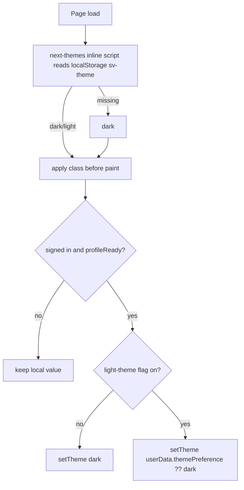

# Theme Preference (Dark / Light)

Let each signed-in user pick a dark or light theme. The choice is saved on their user profile and follows them across devices. Today the app only renders the dark "Floodlight" palette.

## Status

| Field | Value |
|-------|-------|
| Status | in-progress |
| Owner session | Orchestrated: one agent session and one PR per implementation step (below) |
| Last updated | 2026-11-03 |
| Related PR / branch | Plan: [#126](https://github.com/orkunozekin/soccer-team-builder/pull/126). Step 1: [#128](https://github.com/orkunozekin/soccer-team-builder/pull/128) (`orkun/theme-step-1-preference-plumbing`). Step 2: [#129](https://github.com/orkunozekin/soccer-team-builder/pull/129) (`orkun/theme-step-2-color-tokens`). Step 3: [#130](https://github.com/orkunozekin/soccer-team-builder/pull/130) (`orkun/theme-step-3-hardcoded-colors`). Step 4: [#131](https://github.com/orkunozekin/soccer-team-builder/pull/131) (`orkun/theme-step-4-theme-runtime`). Step 5: [#132](https://github.com/orkunozekin/soccer-team-builder/pull/132) (`orkun/theme-step-5-sidebar-toggle`) |

## Goals (v1)

- **Light palette ("Daylight")** — a real light theme for every surface that uses the Floodlight tokens, not the leftover shadcn defaults in `:root`.
- **Per-user preference** — `themePreference: 'dark' | 'light'` on `users/{uid}`, written only through `PATCH /api/users/me`. A missing value means `dark`, so existing users see no change.
- **Switch UI** — an icon-only Dark / Light toggle in the sidebar account footer, next to the username (desktop rail and mobile sheet). Changing it applies right away and persists.
- **No flash on load** — the stored theme is applied before first paint on reload, and the profile value wins once it loads.
- **Flag-gated** — the switch is only shown when the LaunchDarkly flag `light-theme` is on (default `false`). With the flag off, everyone stays on dark, whatever their stored value.
- **Out of scope for v1:**
  - A "System" option that follows `prefers-color-scheme` (see Later).
  - Per-club or white-label theming / brand colors.
  - Restyling the pitch lineup surface (it stays green/dark in both themes).
  - Email templates, OG images.

## Implementation steps (one PR each)

Each step ships as its own PR, in this order. Each one merges before the next starts. Every step keeps the app looking exactly as it does today until step 4 adds the runtime, and only users with the flag on see anything new.

| Step | Todos | Scope | Visible change |
|------|-------|-------|----------------|
| 1. Preference plumbing | 1–4 (+ their tests) | flag key, `themePreference` type/normalizer, hydration mapping, API field + client | none |
| 2. Color tokens + Daylight values | 5, 6 | Floodlight names → CSS vars; Daylight values in `:root`; light `pitch-bg` / `pitch-stripes` / `html` | none (`<html>` is still hardcoded `dark`) |
| 3. Hard-coded color cleanup | 10, 11 | `mist`, `dim`, `live-*`, `ok-pill`, `on-bright` tokens; replace arbitrary hex classes | none in dark |
| 4. Theme runtime | 7, 8 (+ `ThemeSync` tests) | `next-themes`, `ThemeProvider`, `ThemeSync`, layout changes | none while the flag is off / no stored light preference |
| 5. Sidebar toggle | 9 (+ toggle tests) | `ThemeToggle` in the account footer | flag on: toggle appears |
| 6. Light QA + docs | 12 | screenshot pass in light at 320 / tablet / desktop, fix what's unreadable, `docs/TECH_STACK.md`, mark plan done | light fixes only |

## Todos

1. Add the `light-theme` flag key + default `false` + `NEXT_PUBLIC_FF_LIGHT_THEME` local override in [`lib/flags/featureFlags.ts`](../../lib/flags/featureFlags.ts); update `.env.sample`.
2. Add a `ThemePreference` type and an optional `themePreference` field to `User` / `UserFirestore` in [`types/user.ts`](../../types/user.ts), plus a `normalizeThemePreference(value: unknown): ThemePreference` helper (anything except `'light'` becomes `'dark'`), with tests.
3. Map the field in [`components/auth/AuthProvider.tsx`](../../components/auth/AuthProvider.tsx) (around the `userData` build) and in `mapDocToUser` in [`lib/services/userService.ts`](../../lib/services/userService.ts).
4. API: accept `themePreference` in [`app/api/users/me/route.ts`](../../app/api/users/me/route.ts) (strict `'dark' | 'light'` check, 400 for anything else, added to `changedFields`); extend `updateProfileAPI` in [`lib/api/client.ts`](../../lib/api/client.ts). Add cases to `route.test.ts`.
5. Tokenize the Floodlight palette. Move `ink`, `rail`, `turf`, `turf.raised`, `line`, `chalk`, `fog` (and `flare`/`lime` if they need light variants) in [`tailwind.config.ts`](../../tailwind.config.ts) from hex to `rgb(var(--fl-*) / <alpha-value>)`. Define the dark values under `.dark` and the light values under `:root` in [`app/globals.css`](../../app/globals.css). This flips all ~28 consuming files without touching them.
6. Design the Daylight values for the shadcn HSL tokens in `:root` (replace the pinkish legacy defaults), `.pitch-bg`, `.pitch-stripes`, `html` background / `color-scheme` / `accent-color`.
7. Theme runtime: add `next-themes` (`attribute="class"`, `themes={['dark','light']}`, `defaultTheme="dark"`, `enableSystem={false}`, `storageKey="sv-theme"`). Wrap it in a `ThemeProvider` under `components/providers/`, remove the hardcoded `className="dark"` from [`app/layout.tsx`](../../app/layout.tsx), and add `suppressHydrationWarning` on `<html>`.
8. `ThemeSync` client component (mounted inside `AuthProvider` + `LaunchDarklyProvider`): once `profileReady`, call `setTheme(flagOn ? userData.themePreference ?? 'dark' : 'dark')`. Generation-guard on uid so a fast account switch can't apply the previous user's theme.
9. `ThemeToggle` component, rendered by [`AccountMenu.tsx`](../../components/layout/AccountMenu.tsx) on the same row as the username (so it appears in both the desktop rail and the mobile sheet). It's two icon-only buttons, Moon (dark) and Sun (light) from `lucide-react`. Each has an `aria-label` ("Dark theme" / "Light theme"), `aria-pressed`, a 44px hit area and a visible focus ring, wrapped in a `role="group"` labelled "Theme". It only renders when `useFeatureFlag('light-theme')` is true. Optimistic `setTheme` + `updateProfileAPI({ themePreference })` + `setUserData` merge. On failure, revert to the previous theme and show a sanitized error (e.g. a small `role="alert"` line under the row). The username must still truncate and the row must wrap at 320px (see the narrow-rows rule in `AGENT_CONTEXT.md`).
10. Tokenize the arbitrary hex classes that the Tailwind remap won't catch (found while designing):
    - `text-[#B9C2BD]` (~20 uses: `PageHeader`, `SidenavLink`, `filter-pill`, `status-pill`, `AuthPageShell`, `LoginForm`, `MatchDetails`, `RosterFillMeter`, `TeamToggle`, …) → new `mist` token.
    - `text-[#6F7B74]` in [`RosterFillMeter.tsx`](../../components/matches/RosterFillMeter.tsx) → new `dim` token.
    - `text-[#FFB3AA]` (live status) in [`matchStatusText.ts`](../../components/matches/matchStatusText.ts) and [`status-pill.tsx`](../../components/ui/status-pill.tsx), plus the pill fills/borders `#1E1412` / `#4A1E19` / `#1A2A12` / `#3B5A22` (also in [`MatchDetails.tsx`](../../components/matches/MatchDetails.tsx)) → `live-text`, `live-pill`, `ok-pill` tokens.
    - `text-ink` on surfaces that **don't** flip (the white RSVP pill in [`NextMatchHero.tsx`](../../components/matches/NextMatchHero.tsx), the orange [`ProfileBadge.tsx`](../../components/layout/ProfileBadge.tsx)) → new fixed `on-bright` (#0B0F0D). Once `ink` flips, these would be light text on a light fill. `bg-chalk text-ink` pairs (filter pill, hero non-live pill) flip together and are fine.
    - `shadow-2xl shadow-black/40` on the auth panel ([`AuthPageShell.tsx`](../../components/auth/AuthPageShell.tsx)) is too heavy on light; use a softer shadow in light.
11. Audit the remaining hard-coded colors: `bg-white` in [`RSVPSuccessCelebration.tsx`](../../components/matches/RSVPSuccessCelebration.tsx), `text-white` / `bg-zinc-500` in [`BenchList.tsx`](../../components/teams/BenchList.tsx), [`TeamsDisplay.tsx`](../../components/teams/TeamsDisplay.tsx), [`PlayerRsvpHistory.tsx`](../../components/admin/PlayerRsvpHistory.tsx), `text-red-400` / `bg-red-900/40` in `AuditEventLog.tsx`, and the `bg-black/60` overlays (probably fine as they are). Fix only what's actually unreadable.
12. Visual QA in both themes at 320px / tablet / desktop: login, match list, match detail, RSVP flow, teams, admin pages, dialogs/sheets.
13. Tests: route validation, `normalizeThemePreference`, `ThemeSync` (flag off → dark; flag on → stored value; uid change resets), `ThemeToggle` (hidden with the flag off; optimistic switch + revert on API error; `aria-pressed` reflects the theme).

## Current state

- [`app/layout.tsx`](../../app/layout.tsx) hardcodes `<html lang="en" className="dark">`. There's no theme provider and `next-themes` isn't installed.
- [`tailwind.config.ts`](../../tailwind.config.ts) already has `darkMode: ['class']`.
- [`app/globals.css`](../../app/globals.css):
  - `:root` holds stale shadcn light defaults (primary `0 100% 40%`, white card). They've never been designed against the current UI.
  - `.dark` holds the Floodlight palette (ink/turf/chalk/fog/flare).
  - `.pitch-bg` has a pinkish light gradient and a `.dark .pitch-bg` override. `.pitch-stripes` is dark-only turf.
  - `html` defaults to `#fff3f2`, and `html.dark` sets `#0b0f0d`, `color-scheme: dark`, `accent-color`.
- **Main risk:** the Floodlight colors (`ink`, `rail`, `turf`, `line`, `chalk`, `fog`, `flare`, `lime`) are **literal hex Tailwind colors**, used directly in ~28 files (~115 class uses, e.g. `text-chalk`, `text-fog`, `bg-turf-raised`, `border-line`). They don't respond to `.dark`. There are **zero** `dark:` variants in `app/` / `components/`. Flipping the class alone would leave light-on-light text everywhere, so todo 5 is required.
- User profile: [`types/user.ts`](../../types/user.ts). The client hydrates `userData` in [`AuthProvider.tsx`](../../components/auth/AuthProvider.tsx) into [`store/authStore.ts`](../../store/authStore.ts) and gates readiness on `profileReady`. Writes go through `PATCH /api/users/me` ([`route.ts`](../../app/api/users/me/route.ts)), which uses a per-field allowlist and an audit log.
- Firestore rules let a user write their own `users/{uid}` doc, but every profile mutation goes through the API by convention. Keep it that way.
- Flags: [`lib/flags/featureFlags.ts`](../../lib/flags/featureFlags.ts) (`pitch-lineup-view`, `club-creation`), client hook `useFeatureFlag`.
- [`lib/constants/teamColors.ts`](../../lib/constants/teamColors.ts) uses `#0B0F0D` for contrast text on pinny colors. That's independent of the theme, so leave it.

## Design

### Data model

| Field | Collection | Type | Default | Written by |
|-------|------------|------|---------|-----------|
| `themePreference` | `users/{uid}` | `'dark' \| 'light'` (optional) | absent → `dark` | `PATCH /api/users/me` only |

No migration or backfill. No index (it's never queried).

### API

`PATCH /api/users/me` body gains `themePreference?: 'dark' | 'light'`.

- Any other value (including `null`, `'system'`, numbers) returns `400 Invalid themePreference` via `profileUpdateFailed`.
- It's added to `changedFields`, so the audit log records `fields: ['themePreference']`.
- It isn't validated against the flag on the server. Storing a preference is harmless, and the client ignores it while the flag is off.

### Theme resolution (client)



- localStorage is just a first-paint cache. The Firestore profile is the source of truth for signed-in users.
- Signed-out pages (login, signup, invite) use the cached value, or dark if there isn't one. Sign-out doesn't clear the cache: the next user's profile overrides it once loaded.
- Wait for the LD flag to be ready before forcing dark, so a slow LD init doesn't flip a light user to dark and back. If LD is unavailable (fail-closed), dark is correct.

### Token strategy

Use one set of names that both themes define, instead of adding `dark:` classes everywhere (this matches the repo's existing token approach).

```css
:root {            /* Daylight */
  --fl-ink: 245 244 238;   /* #F5F4EE page ground */
  --fl-chalk: 18 24 21;    /* #121815 primary text */
  --fl-fog: 86 97 91;      /* #56615B secondary text */
  /* turf, turf-raised, rail, line, flare, lime … (table below) */
}
.dark {            /* Floodlight (existing hex values, as RGB triplets) */
  --fl-ink: 11 15 13;      /* #0B0F0D */
  --fl-chalk: 243 241 234; /* #F3F1EA */
  --fl-fog: 154 165 159;   /* #9AA59F */
}
```

```ts
chalk: 'rgb(var(--fl-chalk) / <alpha-value>)',
```

**Proposed Daylight palette** (from the design canvas: [Soccerville Daylight Theme](https://claude.ai/artifact/WxiJNNTkc7f14wSQaSCiaj)). Contrast is against `#F5F4EE`; every text token passes AA.

| Token | Role | Floodlight | Daylight | Contrast |
|-------|------|-----------|----------|----------|
| `ink` | page ground, `html` bg | `#0B0F0D` | `#F5F4EE` | — |
| `rail` | side rail, mobile header, sheets | `#0F1411` | `#ECEAE2` | decor |
| `turf` | cards, hover wash | `#131A16` | `#FFFFFF` | decor |
| `turf-raised` | active nav, raised chips | `#1C2420` | `#EEF0EA` | decor |
| `line` | borders, dashed dividers | `#2F3A34` | `#D3D8D1` | decor |
| `chalk` | primary text | `#F3F1EA` | `#121815` | 16.3:1 |
| `mist` (new) | lede, nav labels | `#B9C2BD` | `#3F4A44` | 8.4:1 |
| `fog` | secondary text, eyebrows | `#9AA59F` | `#56615B` | 5.8:1 |
| `dim` (new) | roster capacity | `#6F7B74` | `#636D67` | 4.9:1 |
| `flare` | errors, focus ring, outline button | `#FF5A4A` | `#C42617` | 5.2:1 |
| `lime` | success text, location pin | `#BAE87B` | `#3B7A0F` | 4.8:1 |
| `live-text` (new) | live status line | `#FFB3AA` | `#B42318` | 6.0:1 |
| `live-pill` bg / border (new) | status pill | `#1E1412` / `#4A1E19` | `#FCE9E6` / `#F3C2BB` | text 5.6:1 |
| `ok-pill` bg / border (new) | success pill | `#1A2A12` / `#3B5A22` | `#EAF3E0` / `#BFD8A6` | text 4.6:1 |
| `pitch-stripes` | auth hero band | `#102619` / `#133020` | `#DCE9D6` / `#D1E2CA` | decor |
| `primary` | card red (unchanged) | `#D72A1C` | `#D72A1C` | white on it 5.0:1 |
| `on-bright` (new, fixed) | dark text on white/orange pills | `#0B0F0D` | `#0B0F0D` | — |

shadcn HSL tokens in `:root` follow the same values: `--background` = ink, `--card`/`--popover` = turf, `--border` `#E1E4DE`, `--input` `#CDD3CC`, `--muted-foreground` = fog, `--ring` = `#D72A1C`.

**Approved** by the product owner on 2026-11-03. Implement these values as given.

`chalk` now means "foreground" rather than literal chalk in light mode. That's an accepted naming wart for v1. Renaming to semantic names is a separate refactor (see Later).

### UX

- Sidebar account footer (desktop rail + mobile sheet), on the username row: `[Username …truncates…] [☾][☀]`. Icon-only buttons: Moon = dark, Sun = light. The active one is filled (`bg-turf-raised text-chalk`) and the inactive one is muted (`text-mist`). It only renders when `useFeatureFlag('light-theme')` is true.
- The switch applies instantly. The API write runs in the background with a busy state (both buttons disabled). On error, revert and show a sanitized inline message.
- No Profile-page Appearance card in v1. The sidebar toggle replaces it (the design canvas's Profile artboard shows an earlier option).

## Critical decisions

- **Default stays dark.** Missing field, flag off, LD down, or signed out with no cache all resolve to dark. No existing user should see a change at merge.
- **Write through the API, not the client SDK**, to keep validation and audit consistent with the other profile fields.
- **Don't touch the ~28 consumer files for color.** Re-pointing the Tailwind color names at CSS variables is what keeps the diff small. Edit consumer files only for real hard-coded `white`/`black`/hex problems.
- **Opacity modifiers must keep working.** Make sure existing `text-chalk/70`-style classes still work with the `rgb(var() / <alpha-value>)` form, which is why the variables hold RGB triplets rather than hex.
- **Hydration:** `next-themes` mutates `<html>` before React hydrates. `suppressHydrationWarning` on `<html>` is required. Don't read the theme during SSR to choose markup. Theme-dependent icons (e.g. sun/moon) must render after mount.
- **Guard the async apply.** `ThemeSync` must not apply a stale user's preference after a uid change (same generation-guard rule as in `AGENT_CONTEXT.md`).
- Pitch lineup tokens (`--pitch-*`) keep their current values in both themes unless QA shows a problem. The field is meant to look like grass.

## Files to touch

| Path | Change |
|------|--------|
| `package.json` / `yarn.lock` | add `next-themes` |
| [`lib/flags/featureFlags.ts`](../../lib/flags/featureFlags.ts) | `light-theme` key, default, local override |
| `.env.sample` | `NEXT_PUBLIC_FF_LIGHT_THEME` |
| [`types/user.ts`](../../types/user.ts) | `ThemePreference`, field, `normalizeThemePreference` |
| [`components/auth/AuthProvider.tsx`](../../components/auth/AuthProvider.tsx) | map `themePreference` |
| [`lib/services/userService.ts`](../../lib/services/userService.ts) | map `themePreference` in `mapDocToUser` |
| [`app/api/users/me/route.ts`](../../app/api/users/me/route.ts) (+ `route.test.ts`) | validate + persist field |
| [`lib/api/client.ts`](../../lib/api/client.ts) | `updateProfileAPI` param |
| [`tailwind.config.ts`](../../tailwind.config.ts) | Floodlight colors → CSS vars |
| [`app/globals.css`](../../app/globals.css) | Daylight tokens in `:root`, Floodlight vars in `.dark`, `pitch-bg`/`pitch-stripes`/`html` light variants |
| [`app/layout.tsx`](../../app/layout.tsx) | drop hardcoded `dark`, `suppressHydrationWarning`, mount `ThemeProvider` + `ThemeSync` |
| `components/providers/ThemeProvider.tsx` (new) | `next-themes` wrapper |
| `components/providers/ThemeSync.tsx` (new, + test) | profile → theme sync |
| `components/layout/ThemeToggle.tsx` (new, + test) | icon-only switch |
| [`components/layout/AccountMenu.tsx`](../../components/layout/AccountMenu.tsx) (+ `AccountMenu.test.tsx`) | render `ThemeToggle` beside the username |
| Hard-coded color spots (todos 10–11) | new tokens + targeted fixes only |
| [`docs/TECH_STACK.md`](../TECH_STACK.md) | note `next-themes` + token approach |

## Acceptance criteria

- [ ] Flag off: the app is pixel-identical to today for every user (dark), and no theme toggle is shown.
- [ ] Flag on: a user can switch Dark ↔ Light from the sidebar toggle. It applies instantly and survives reload with no dark/light flash.
- [ ] The preference follows the user to another browser/device after sign-in.
- [ ] Signing in as a different user on the same device applies that user's preference (or dark).
- [ ] `PATCH /api/users/me` rejects invalid `themePreference` values with 400 and audit-logs valid changes.
- [ ] Every page reviewed in light at 320px, tablet and desktop. Text tokens meet WCAG AA on their surfaces, and nothing is light-on-light or invisible.
- [ ] No hydration warnings in the console. `yarn test:run`, lint and typecheck pass.

## Later

- `System` option (`enableSystem`, `'system'` stored value) that follows `prefers-color-scheme`.
- Rename Floodlight color names to semantic tokens (`surface`, `text-muted`, …).
- Remove the flag once Daylight is polished and rolled out.

## Handoff

> Updated by `/handoff`. `/feature-context` reads this first.

### Done so far

- Plan written. No code changes yet.
- Design canvas published: [Soccerville Daylight Theme](https://claude.ai/artifact/WxiJNNTkc7f14wSQaSCiaj). It has the token map, Matches (Floodlight vs Daylight), Profile → Appearance (interactive) and Sign in (Daylight). The link is private to the owner until it's shared.

- Daylight palette approved. The `light-theme` flag has been created in LaunchDarkly and is on in the Test environment.
- **Step 1: preference plumbing** ([#128](https://github.com/orkunozekin/soccer-team-builder/pull/128), todos 1–4):
  - `lib/flags/featureFlags.ts`: `light-theme` key, default `false`, `NEXT_PUBLIC_FF_LIGHT_THEME` override (+ `.env.sample`, `featureFlags.test.ts`).
  - `types/user.ts`: `ThemePreference`, optional `themePreference` on `User` / `UserFirestore`, `normalizeThemePreference` (`types/user.test.ts`).
  - Hydration: `themePreference` mapped (normalized) in `AuthProvider` `userData` and `mapDocToUser`. So `userData.themePreference` is always `'dark' | 'light'` once the profile loads.
  - `PATCH /api/users/me`: strict `'dark' | 'light'`, else `400 Invalid themePreference`; in `changedFields`. `updateProfileAPI({ themePreference })` (`route.test.ts` cases added).

- **Step 2: color tokens + Daylight values** ([#129](https://github.com/orkunozekin/soccer-team-builder/pull/129), todos 5–6):
  - `tailwind.config.ts`: `ink`, `rail`, `turf` (+ `raised`), `line`, `chalk`, `fog`, `flare`, `lime` are `rgb(var(--fl-*) / <alpha-value>)`. Opacity modifiers (`border-line/60`, `bg-rail/95`, …) still compile.
  - `app/globals.css`: `--fl-*` RGB triplets. `.dark` has the exact Floodlight hex values, and `:root` has the approved Daylight values. The `:root` shadcn HSL tokens are now Daylight, and `:root --radius` matches dark (`0.875rem`). Light `.pitch-bg` is `#F5F4EE` with a faint lime radial. `.pitch-stripes` uses `--pitch-stripe-a/b` (Floodlight `#102619`/`#133020`, Daylight `#DCE9D6`/`#D1E2CA`). The light `html` rule sets `#F5F4EE`, `color-scheme: light` and `accent-color: #D72A1C`. The `--pitch-*` lineup tokens are unchanged.
  - Verified dark is pixel-identical on `/login`, `/register`, `/forgot-password`, `/join` (375 + 1280). In a light spot-check (`dark` class removed by hand), the `text-[#B9C2BD]` lede is faint and the auth card shadow is heavy. Both are step 3.

- **Step 3: hard-coded color cleanup** ([#130](https://github.com/orkunozekin/soccer-team-builder/pull/130), todos 10–11):
  - New tokens (same `--fl-*` RGB-triplet pattern; `.dark` values equal the hex they replace): `mist`, `dim`, `live-text`, `live-pill` / `live-pill-border`, `ok-pill` / `ok-pill-border`, plus `danger` / `danger-wash` (dark = Tailwind `red-400` / `red-900`, light `#B42318` / `#F3C2BB`). `on-bright` (`#0B0F0D`) is defined once in `:root` and is the same in both themes. `elevation` holds a full shadow color with alpha (`0 0 0 / 0.4` dark, `18 24 21 / 0.12` light) for `shadow-elevation`.
  - No `[#…]` arbitrary color classes are left in `app/` / `components/`. `text-[#B9C2BD]` → `text-mist`, `text-[#6F7B74]` → `text-dim`, status pill / match success card → `live-*` / `ok-pill*`, `bg-[#FF8641]` → `bg-pinny-orange`.
  - `text-on-bright` on the white live RSVP pill (`NextMatchHero`) and the orange `ProfileBadge`. `PlayerMarker` current-user border → `border-on-bright` (the pitch doesn't flip). `bg-chalk text-ink` pairs left alone.
  - `AuthPageShell` panel: `shadow-black/40` → `shadow-elevation`. `AuditEventLog` failed rows: `text-red-400` / `bg-red-900/40` → `text-danger` / `bg-danger-wash/40`.
  - Dark verified pixel-identical vs `main` on emulators: `/login`, `/register`, `/forgot-password`, `/join`, `/matches`, match detail, `/profile`, club settings, roster (375 + 1280).
  - Left for step 6 (readable enough or decorative): ~35 other `text-red-400` error lines and `bg-red-900/20` banners (swap to `text-danger` then), `text-red-200` / `text-red-300` on `bg-red-950/40` alerts (`TeamsDisplay`, `PlayerTransfer`, `MatchDetailView`), white confetti pieces in `RSVPSuccessCelebration`, `ring-chalk` on the current-user `PlayerMarker` (dark ring on the pitch in light), the flare glow `rgba(255,90,74,…)` on the live dot. Fixed fills with white text (`BenchList` zinc, `PlayerRsvpHistory` emerald/red, team colors) and `bg-black/60–80` overlays are fine.

- **Step 4: theme runtime** ([#131](https://github.com/orkunozekin/soccer-team-builder/pull/131), todos 7–8 + `ThemeSync` tests):
  - `next-themes` 0.4.6. `components/providers/ThemeProvider.tsx` wraps it (`attribute="class"`, `themes={['dark','light']}`, `defaultTheme="dark"`, `enableSystem={false}`, `storageKey="sv-theme"`, `disableTransitionOnChange`). Use `useTheme()` from `next-themes` for `theme` / `setTheme`. `THEME_STORAGE_KEY` is exported.
  - `app/layout.tsx`: no hardcoded `dark`, `suppressHydrationWarning` on `<html>`, `ThemeProvider` wraps everything in `<body>`. `ThemeSync` is mounted inside `AuthProvider` + `LaunchDarklyProvider`.
  - `components/providers/ThemeSync.tsx`: once signed in, `profileReady` and flags ready, it sets dark (flag off) or `normalizeThemePreference(userData.themePreference)` (flag on). It only applies a profile whose `uid` matches the auth uid. Signed out, pending profile or loading flags → no change (the cached value stays).
  - Flags readiness: `FeatureFlagsReadyContext` (default `true`) + `useFeatureFlagReady(key)` in `lib/flags/useFeatureFlag.ts`. `LaunchDarklyProvider` tracks readiness per LD context key (uid / `anonymous`). It's fail-closed: no client ID, init error/timeout, or a 12 s fallback timer count as ready. A local `NEXT_PUBLIC_FF_*` override is always ready.
  - next-themes puts `dark` or `light` on `<html>`. No CSS targets `.light`, so light comes from `:root` alone.
  - Verified: dark pixel-identical vs `main` on the step 3 routes (375 + 1280, production builds, emulators). No hydration or console warnings. With `NEXT_PUBLIC_FF_LIGHT_THEME=true` (only honored by `next dev`) and a cached `sv-theme=light`, a light user is light from first paint with no dark flash, and a user without a preference ends dark.

- **Step 5: sidebar toggle** ([#132](https://github.com/orkunozekin/soccer-team-builder/pull/132), todo 9 + `ThemeToggle` tests):
  - `components/layout/ThemeToggle.tsx`: icon-only Moon / Sun buttons in a `role="group"` labelled "Theme", each with `aria-label`, `aria-pressed`, a 44px hit area (`h-11 w-11`) and a `focus-visible` ring. Active = `bg-turf-raised text-chalk`, inactive = `text-mist` (hover `text-chalk`). Renders only when `light-theme` is on **and** ready. `aria-pressed` is only set after mount (hydration).
  - Click: `setTheme(next)` at once, then `updateProfileAPI({ themePreference })`; both buttons are disabled (`aria-busy` on the group) while saving. Success merges `themePreference` into `userData` via the new `authStore.mergeUserData(uid, patch)` (current profile, uid-checked). `ProfileForm`, `ProfileCompleteModal`, `ProfileClubsSection` and `useClubWorkspace` now use it too, so concurrent profile/club/theme writes don't overwrite each other, and `ProfileForm` / `ProfileCompleteModal` only resync their inputs when the fields it shows change. Failure reverts to the previous theme, then bumps `resyncCount` so `ThemeSync` re-resolves from the current flag and profile (the flag turning off mid-save still ends dark), and shows a fixed `role="alert"` line in `text-flare` (no server text). The busy flag, error and request counter live in `store/themeSaveStore.ts` (written by `lib/theme/saveThemePreference.ts`; keyed by uid, shared by the rail and sheet toggles, kept across unmounts), and every write or rollback re-checks the latest request and the current auth uid.
  - `AccountMenu.tsx`: the username and toggle share one `flex flex-wrap` row; the name keeps `min-w-0 flex-1 truncate`, the group is `shrink-0`, and the alert is `basis-full` so it wraps under the row. Same component in the desktop rail and the mobile sheet.
  - Verified on emulators (`next dev`, `NEXT_PUBLIC_FF_LIGHT_THEME=true`): toggling from the rail (1280) and the sheet (320) applies at once and writes `themePreference` to the user doc; the choice survives reload. Flag off (production builds): no toggle, and `/login`, `/register`, `/forgot-password`, `/join`, signed-in `/join`, `/profile`, `/clubs` (sheet open on mobile) are byte-identical to `main` at 375 and 1280.
  - Emulator note: `EmulatorAuthGate` signs out on every full page load, so "reload keeps the choice" means the cached theme applies before paint and the profile value applies again after signing in. Navigate client-side for signed-in screenshots.
  - For step 6: in light, the active button's `turf-raised` fill on `rail` is subtle. Check it in the QA pass.

### Remaining work

1. **Step 6: light QA + docs** (todo 12, table above), one PR: screenshot pass in light at 320 / tablet / desktop, fix what's unreadable (including the step 3 leftovers listed above and the toggle's active-state contrast on `rail`), `docs/TECH_STACK.md`, mark the plan done.

Each step's agent updates this Handoff in its own PR: it adds the PR link under Done so far and moves the next step to the top of Remaining work.

### Blockers / risks

- The `light-theme` flag is off in Production. Leave it that way until step 6 is merged and QA'd.

### Pointers for the next agent

- Start at: the first implementation step not yet listed under Done so far.
- Do not: sprinkle `dark:` variants across components; write the preference via the client Firestore SDK; change the default away from dark.
- Verify with: `yarn test:run`; manual pass in both themes on emulators (`NEXT_PUBLIC_USE_FIREBASE_EMULATOR=true`, `NEXT_PUBLIC_FF_LIGHT_THEME=true`).
