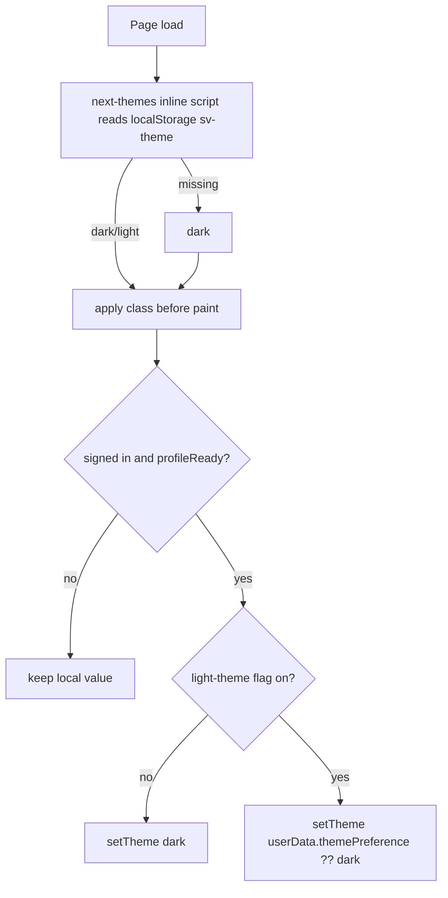

# Theme Preference (Dark / Light)

Let each signed-in user pick a dark or light theme. The choice is saved on their user profile and follows them across devices. Today the app only renders the dark "Floodlight" palette.

## Status

| Field | Value |
|-------|-------|
| Status | planned |
| Owner session | — |
| Last updated | 2026-11-03 |
| Related PR / branch | `orkun/eloquent-cray-xqz6fr` (plan only) |

## Goals (v1)

- **Light palette ("Daylight")** — a real light theme for every surface that uses the Floodlight tokens, not the leftover shadcn defaults in `:root`.
- **Per-user preference** — `themePreference: 'dark' | 'light'` on `users/{uid}`, written only through `PATCH /api/users/me`. A missing value means `dark`, so existing users see no change.
- **Switch UI** — an "Appearance" control on the Profile page. Changing it applies right away and persists.
- **No flash on load** — the stored theme is applied before first paint on reload, and the profile value wins once it loads.
- **Flag-gated** — the switch is only shown when the LaunchDarkly flag `light-theme` is on (default `false`). With the flag off, everyone stays on dark, whatever their stored value.
- **Out of scope for v1:**
  - A "System" option that follows `prefers-color-scheme` (see Later).
  - Per-club or white-label theming / brand colors.
  - Restyling the pitch lineup surface (it stays green/dark in both themes).
  - Email templates, OG images.

## Todos

1. Add the `light-theme` flag key + default `false` + `NEXT_PUBLIC_FF_LIGHT_THEME` local override in [`lib/flags/featureFlags.ts`](../../lib/flags/featureFlags.ts); update `.env.sample`.
2. Add a `ThemePreference` type and an optional `themePreference` field to `User` / `UserFirestore` in [`types/user.ts`](../../types/user.ts), plus a `normalizeThemePreference(value: unknown): ThemePreference` helper (anything except `'light'` becomes `'dark'`), with tests.
3. Map the field in [`components/auth/AuthProvider.tsx`](../../components/auth/AuthProvider.tsx) (around the `userData` build) and in `mapDocToUser` in [`lib/services/userService.ts`](../../lib/services/userService.ts).
4. API: accept `themePreference` in [`app/api/users/me/route.ts`](../../app/api/users/me/route.ts) (strict `'dark' | 'light'` check, 400 for anything else, added to `changedFields`); extend `updateProfileAPI` in [`lib/api/client.ts`](../../lib/api/client.ts). Add cases to `route.test.ts`.
5. Tokenize the Floodlight palette. Move `ink`, `rail`, `turf`, `turf.raised`, `line`, `chalk`, `fog` (and `flare`/`lime` if they need light variants) in [`tailwind.config.ts`](../../tailwind.config.ts) from hex to `rgb(var(--fl-*) / <alpha-value>)`. Define the dark values under `.dark` and the light values under `:root` in [`app/globals.css`](../../app/globals.css). This flips all ~28 consuming files without touching them.
6. Design the Daylight values for the shadcn HSL tokens in `:root` (replace the pinkish legacy defaults), `.pitch-bg`, `.pitch-stripes`, `html` background / `color-scheme` / `accent-color`.
7. Theme runtime: add `next-themes` (`attribute="class"`, `themes={['dark','light']}`, `defaultTheme="dark"`, `enableSystem={false}`, `storageKey="sv-theme"`). Wrap it in a `ThemeProvider` under `components/providers/`, remove the hardcoded `className="dark"` from [`app/layout.tsx`](../../app/layout.tsx), and add `suppressHydrationWarning` on `<html>`.
8. `ThemeSync` client component (mounted inside `AuthProvider` + `LaunchDarklyProvider`): once `profileReady`, call `setTheme(flagOn ? userData.themePreference ?? 'dark' : 'dark')`. Generation-guard on uid so a fast account switch can't apply the previous user's theme.
9. `AppearanceSettings` component on [`app/profile/page.tsx`](../../app/profile/page.tsx): a two-option segmented control (Dark / Light). Optimistic `setTheme` + `updateProfileAPI({ themePreference })` + `setUserData` merge. On failure, revert to the previous theme and show a sanitized error.
10. Audit hard-coded colors that break on light: `bg-white` in [`RSVPSuccessCelebration.tsx`](../../components/matches/RSVPSuccessCelebration.tsx), `text-white` / `bg-zinc-500` in [`BenchList.tsx`](../../components/teams/BenchList.tsx), [`TeamsDisplay.tsx`](../../components/teams/TeamsDisplay.tsx), [`PlayerRsvpHistory.tsx`](../../components/admin/PlayerRsvpHistory.tsx), the `shadow-[inset_…red.50]` rail in [`SidenavLink.tsx`](../../components/layout/SidenavLink.tsx), and the `bg-black/60` overlays (probably fine as they are). Fix only what's actually unreadable.
11. Visual QA in both themes at 320px / tablet / desktop: login, match list, match detail, RSVP flow, teams, admin pages, dialogs/sheets.
12. Tests: route validation, `normalizeThemePreference`, `ThemeSync` (flag off → dark; flag on → stored value; uid change resets), `AppearanceSettings` (optimistic switch + revert on API error).

## Current state

- [`app/layout.tsx`](../../app/layout.tsx) hardcodes `<html lang="en" className="dark">`. There's no theme provider and `next-themes` isn't installed.
- [`tailwind.config.ts`](../../tailwind.config.ts) already has `darkMode: ['class']`.
- [`app/globals.css`](../../app/globals.css):
  - `:root` holds stale shadcn light defaults (primary `0 100% 40%`, white card). They've never been designed against the current UI.
  - `.dark` holds the Floodlight palette (ink/turf/chalk/fog/flare).
  - `.pitch-bg` has a pinkish light gradient and a `.dark .pitch-bg` override. `.pitch-stripes` is dark-only turf.
  - `html` defaults to `#fff3f2`, and `html.dark` sets `#0b0f0d`, `color-scheme: dark`, `accent-color`.
- **Main risk:** the Floodlight colors (`ink`, `rail`, `turf`, `line`, `chalk`, `fog`, `flare`, `lime`) are **literal hex Tailwind colors**, used directly in ~28 files (~115 class uses, e.g. `text-chalk`, `text-fog`, `bg-turf-raised`, `border-line`). They don't respond to `.dark`. There are **zero** `dark:` variants in `app/` / `components/`. Flipping the class alone would leave light-on-light text everywhere, so todo 5 is required.
- User profile: [`types/user.ts`](../../types/user.ts). The client hydrates `userData` in [`AuthProvider.tsx`](../../components/auth/AuthProvider.tsx) into [`store/authStore.ts`](../../store/authStore.ts) and gates readiness on `profileReady`. Writes go through `PATCH /api/users/me` ([`route.ts`](../../app/api/users/me/route.ts)), which uses a per-field allowlist and an audit log.
- Firestore rules let a user write their own `users/{uid}` doc, but every profile mutation goes through the API by convention. Keep it that way.
- Flags: [`lib/flags/featureFlags.ts`](../../lib/flags/featureFlags.ts) (`pitch-lineup-view`, `club-creation`), client hook `useFeatureFlag`.
- [`lib/constants/teamColors.ts`](../../lib/constants/teamColors.ts) uses `#0B0F0D` for contrast text on pinny colors. That's independent of the theme, so leave it.

## Design

### Data model

| Field | Collection | Type | Default | Written by |
|-------|------------|------|---------|-----------|
| `themePreference` | `users/{uid}` | `'dark' \| 'light'` (optional) | absent → `dark` | `PATCH /api/users/me` only |

No migration or backfill. No index (it's never queried).

### API

`PATCH /api/users/me` body gains `themePreference?: 'dark' | 'light'`.

- Any other value (including `null`, `'system'`, numbers) returns `400 Invalid themePreference` via `profileUpdateFailed`.
- It's added to `changedFields`, so the audit log records `fields: ['themePreference']`.
- It isn't validated against the flag on the server. Storing a preference is harmless, and the client ignores it while the flag is off.

### Theme resolution (client)



- localStorage is just a first-paint cache. The Firestore profile is the source of truth for signed-in users.
- Signed-out pages (login, signup, invite) use the cached value, or dark if there isn't one. Sign-out doesn't clear the cache: the next user's profile overrides it once loaded.
- Wait for the LD flag to be ready before forcing dark, so a slow LD init doesn't flip a light user to dark and back. If LD is unavailable (fail-closed), dark is correct.

### Token strategy

Use one set of names that both themes define, instead of adding `dark:` classes everywhere (this matches the repo's existing token approach).

```css
:root {            /* Daylight */
  --fl-ink: 246 245 240;   /* page ground */
  --fl-chalk: 17 21 19;    /* primary text */
  --fl-fog: 92 102 97;     /* secondary text */
  /* turf, turf-raised, rail, line, flare, lime … */
}
.dark {            /* Floodlight (existing hex values, as RGB triplets) */
  --fl-ink: 11 15 13;      /* #0B0F0D */
  --fl-chalk: 243 241 234; /* #F3F1EA */
  --fl-fog: 154 165 159;   /* #9AA59F */
}
```

```ts
chalk: 'rgb(var(--fl-chalk) / <alpha-value>)',
```

The Daylight values above are placeholders. The final palette needs a design pass (todo 6) that checks WCAG AA contrast for text tokens on the `card` / `turf` surfaces, and that `flare` and the brand red still read correctly on a light ground.

`chalk` now means "foreground" rather than literal chalk in light mode. That's an accepted naming wart for v1. Renaming to semantic names is a separate refactor (see Later).

### UX

- Profile page → new card **Appearance**, with a segmented control: `Dark` / `Light` (radiogroup semantics, keyboard-navigable, 44px hit targets). It only renders when `useFeatureFlag('light-theme')` is true.
- The switch applies instantly. The API write runs in the background with a busy state. On error, revert and toast/inline a sanitized message.

## Critical decisions

- **Default stays dark.** Missing field, flag off, LD down, or signed out with no cache all resolve to dark. No existing user should see a change at merge.
- **Write through the API, not the client SDK**, to keep validation and audit consistent with the other profile fields.
- **Don't touch the ~28 consumer files for color.** Re-pointing the Tailwind color names at CSS variables is what keeps the diff small. Edit consumer files only for real hard-coded `white`/`black`/hex problems.
- **Opacity modifiers must keep working.** Make sure existing `text-chalk/70`-style classes still work with the `rgb(var() / <alpha-value>)` form, which is why the variables hold RGB triplets rather than hex.
- **Hydration:** `next-themes` mutates `<html>` before React hydrates. `suppressHydrationWarning` on `<html>` is required. Don't read the theme during SSR to choose markup. Theme-dependent icons (e.g. sun/moon) must render after mount.
- **Guard the async apply.** `ThemeSync` must not apply a stale user's preference after a uid change (same generation-guard rule as in `AGENT_CONTEXT.md`).
- Pitch lineup tokens (`--pitch-*`) keep their current values in both themes unless QA shows a problem. The field is meant to look like grass.

## Files to touch

| Path | Change |
|------|--------|
| `package.json` / `yarn.lock` | add `next-themes` |
| [`lib/flags/featureFlags.ts`](../../lib/flags/featureFlags.ts) | `light-theme` key, default, local override |
| `.env.sample` | `NEXT_PUBLIC_FF_LIGHT_THEME` |
| [`types/user.ts`](../../types/user.ts) | `ThemePreference`, field, `normalizeThemePreference` |
| [`components/auth/AuthProvider.tsx`](../../components/auth/AuthProvider.tsx) | map `themePreference` |
| [`lib/services/userService.ts`](../../lib/services/userService.ts) | map `themePreference` in `mapDocToUser` |
| [`app/api/users/me/route.ts`](../../app/api/users/me/route.ts) (+ `route.test.ts`) | validate + persist field |
| [`lib/api/client.ts`](../../lib/api/client.ts) | `updateProfileAPI` param |
| [`tailwind.config.ts`](../../tailwind.config.ts) | Floodlight colors → CSS vars |
| [`app/globals.css`](../../app/globals.css) | Daylight tokens in `:root`, Floodlight vars in `.dark`, `pitch-bg`/`pitch-stripes`/`html` light variants |
| [`app/layout.tsx`](../../app/layout.tsx) | drop hardcoded `dark`, `suppressHydrationWarning`, mount `ThemeProvider` + `ThemeSync` |
| `components/providers/ThemeProvider.tsx` (new) | `next-themes` wrapper |
| `components/providers/ThemeSync.tsx` (new, + test) | profile → theme sync |
| `components/profile/AppearanceSettings.tsx` (new, + test) | switch UI |
| [`app/profile/page.tsx`](../../app/profile/page.tsx) | render `AppearanceSettings` |
| Hard-coded color spots (todo 10) | targeted fixes only |
| [`docs/TECH_STACK.md`](../TECH_STACK.md) | note `next-themes` + token approach |

## Acceptance criteria

- [ ] Flag off: the app is pixel-identical to today for every user (dark), and no Appearance card is shown.
- [ ] Flag on: a user can switch Dark ↔ Light on Profile. It applies instantly and survives reload with no dark/light flash.
- [ ] The preference follows the user to another browser/device after sign-in.
- [ ] Signing in as a different user on the same device applies that user's preference (or dark).
- [ ] `PATCH /api/users/me` rejects invalid `themePreference` values with 400 and audit-logs valid changes.
- [ ] Every page reviewed in light at 320px, tablet and desktop. Text tokens meet WCAG AA on their surfaces, and nothing is light-on-light or invisible.
- [ ] No hydration warnings in the console. `yarn test:run`, lint and typecheck pass.

## Later

- `System` option (`enableSystem`, `'system'` stored value) that follows `prefers-color-scheme`.
- Quick toggle in the account rail/menu.
- Rename Floodlight color names to semantic tokens (`surface`, `text-muted`, …).
- Remove the flag once Daylight is polished and rolled out.

## Handoff

> Updated by `/handoff`. `/feature-context` reads this first.

### Done so far

- Plan written. No code changes yet.

### Remaining work

- All Todos (1–12). Start with 5–6 (tokenizing + Daylight palette): it's the largest risk and can be checked visually by temporarily removing `dark` from `<html>`, before any preference plumbing.

### Blockers / risks

- The Daylight palette needs design sign-off. The values in this doc are placeholders.
- The `light-theme` flag has to be created in the LaunchDarkly dashboard (both environments) before the toggle can show outside local overrides.

### Pointers for the next agent

- Start at: [`tailwind.config.ts`](../../tailwind.config.ts) Floodlight colors + [`app/globals.css`](../../app/globals.css) `:root` / `.dark`.
- Do not: sprinkle `dark:` variants across components; write the preference via the client Firestore SDK; change the default away from dark.
- Verify with: `yarn test:run`; manual pass in both themes on emulators (`NEXT_PUBLIC_USE_FIREBASE_EMULATOR=true`, `NEXT_PUBLIC_FF_LIGHT_THEME=true`).
