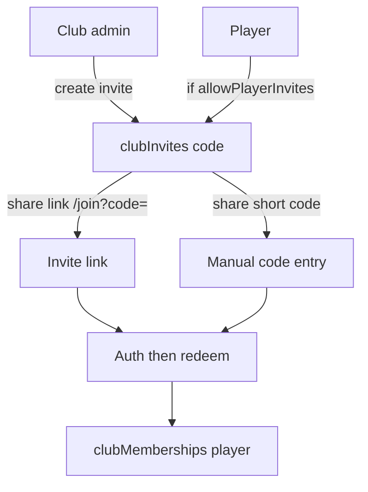

# White-label clubs (multi-tenant membership)

Plan to move Soccerville from a single hard-coded club to multi-club tenancy: rename global `admin` → `super_user`, add club-scoped `club_admin` / player memberships, invite join (link + code), membership backfill onto a club created by a super user, and profile surfaces for clubs / clubs you admin.

## Status

| Field | Value |
|-------|-------|
| Status | in progress (foundation shipped; follow-ups open) |
| Owner session | cloud agent |
| Last updated | 2026-09-26 |
| Merged PR | [#65](https://github.com/orkunozekin/soccer-team-builder/pull/65) (foundation, merged 2026-09-26) |
| Open follow-up PR / branch | [#71](https://github.com/orkunozekin/soccer-team-builder/pull/71) on `cursor/white-label-clubs-8675` (club create UX: name-only, auto slug, unique name/slug; no backfill panel) |
| Founding club | **Jax State Soccer Club** (`eJUFKpdHpRsO3vaisI6G`) — membership + resource `clubId` backfill already run in production |

## Goals (v1)

- **Global role rename** — Replace `admin` with `super_user` everywhere (types, APIs, Firestore rules, UI). No elaborate role backfill; only ~3 current admins (one-shot update or manual is fine).
- **Club entity** — Introduce a first-class **club** (org / white-label tenant). Code and collections use `club` to avoid colliding with match lineup [`types/team.ts`](../../types/team.ts) (`matches/{matchId}/teams`).
- **Membership roles** — A user may belong to many clubs. Per club, role is `player` or `club_admin` (and can differ across clubs). Global `super_user` is orthogonal and not club-scoped.
- **Authorization rewrite** — Replace global `verifyAdmin` / `role == 'admin'` with layered checks: `super_user` (platform), `club_admin` (club ops), membership (read isolation), invite rules. Data scoping via `clubId` is part of this, not the whole story (see **Authorization**).
- **Join via invite** — Club members join through invite **link** or **code**. Club admins always can invite. Players can invite only when the club’s club admin enables “players can invite.”
- **Membership backfill** — After a super user creates the first club (current Soccerville), migrate all existing users onto that club as memberships (players; former global admins → `super_user` globally + `club_admin` on that club unless product decides otherwise).
- **Profile** — Show clubs the user belongs to. Show clubs where they are `club_admin`. From an admin club, share invite link / code.
- **Out of scope for v1:** QR invites, custom branding (logo/colors/domain), billing, cross-club match discovery marketplace, changing match-lineup “team” naming.

## Todos

1. [x] Lock naming: **club** = tenant; membership role **`club_admin`**; keep match **teams** as lineup sides.
2. [x] Data model: `clubs`, `clubMemberships`, `clubInvites`; strip club-scoped meaning from `users.role` (only `user` | `super_user`).
3. [x] **Authorization layer:** `verifySuperUser`, `verifyClubMember(clubId)`, `verifyClubAdmin(clubId)`, invite-create gate; update [`firestore.rules`](../../firestore.rules) and client guards/hooks.
4. [x] Rename `admin` → `super_user` across types, [`lib/api/auth.ts`](../../lib/api/auth.ts), [`useAdmin`](../../lib/hooks/useAdmin.ts), Admin UI labels, UserRoleManager, tests.
5. [x] Club CRUD APIs (super user creates clubs; club admin updates club settings including `allowPlayerInvites`). Create is **name-only**; slug auto-generated; name + slug unique.
6. [x] Invite APIs: create invite; redeem by code or link token; enforce `allowPlayerInvites`. (Revoke API still thin / later.)
7. [~] Registration/login join path: `/join?code=` + login redirect; full invite-aware register polish still open.
8. [x] One-shot backfill route (super-user gated). **Production founding club already backfilled** (Jax State Soccer Club). Backfill admin UI removed; API kept for emergencies only.
9. [x] Profile UI: membership list + “clubs I admin” + invite share (copy link / code).
10. [~] Scope resource reads/writes to `clubId` + membership checks — APIs/rules largely done; tighter client match-list filtering by membership/`activeClubId` still open.
11. [x] Migrate every `verifyAdmin` call site (Wave A / Wave B); tests for auth helpers + migration idempotency.

## Current state

Foundation from [#65](https://github.com/orkunozekin/soccer-team-builder/pull/65) is on `main`. Founding tenant **Jax State Soccer Club** exists; users/matches/schedules/locations were backfilled onto it.

| Area | Today |
|------|--------|
| Global roles | [`types/user.ts`](../../types/user.ts): `UserRole = 'user' \| 'super_user'` (legacy `admin` normalized) |
| Role enforcement | [`lib/api/auth.ts`](../../lib/api/auth.ts) `verifySuperUser` / `verifyClubAdmin` / `verifyClubMember`; [`firestore.rules`](../../firestore.rules); [`useAdmin`](../../lib/hooks/useAdmin.ts) for platform shell |
| Club create | Super user; name required; slug from name; unique name + slug ([#71](https://github.com/orkunozekin/soccer-team-builder/pull/71) polish) |
| Memberships / invites | Collections + APIs; profile invite share; `/join?code=` |
| “Team” | Match lineup only: [`types/team.ts`](../../types/team.ts), `matches/{matchId}/teams` (unchanged) |
| Join | `/join` redeem path; open register still creates orphan accounts without membership |
| Profile | Clubs I’m in / clubs I admin + invite actions |
| Branding | Still hard-coded Soccerville strings in places; not club-configurable (out of v1) |

Related feature plans (`check-in`, pitch lineup, RSVP, QStash) assume global admin and a shared match universe. They do not block this plan but will need club-scoped auth once isolation lands.

## Design

### Naming

| Term | Meaning |
|------|---------|
| **Club** | Tenant / org players belong to (Firestore `clubs`). Prefer this in code. |
| **Club admin** | Club-scoped role (`club_admin` in data). Manages that club’s settings, invites, and club-scoped match ops. |
| **Match team** | Existing lineup side under a match. Unchanged. |
| **Super user** | Global platform operator (`super_user`). Replaces `admin`. |

UI copy should say “club” / “club admin” to match the entity. Do not rename match `teams` collections.

### Role model

```text
users.role: 'user' | 'super_user'              // global only
clubMemberships.role: 'player' | 'club_admin'  // per club
```

- A user can be `club_admin` of club A and `player` of club B simultaneously.
- Do **not** store `club_admin` on `users.role`; membership is the source of truth for club roles.

### Authorization

`clubId` scoping is **data isolation**. Authorization is the **who can do what** layer on top of that. Both are in v1.

#### Capability matrix

| Action | Who |
|--------|-----|
| Create club; platform seed; promote/demote `super_user`; run membership backfill | `super_user` |
| Update club settings (`allowPlayerInvites`, name); club roster admin actions | `club_admin` for that club **or** `super_user` |
| Create / revoke invites | `club_admin` always; `player` only if `settings.allowPlayerInvites` |
| Redeem invite → join as `player` | Any authenticated user with a valid invite |
| Read club matches / schedules / locations | Active membership in that `clubId` (**or** `super_user`) |
| Write match CRUD, generate/rebalance lineup, host check-in, club locations/schedules | `club_admin` for resource’s `clubId` **or** `super_user` |
| Own profile / own RSVP | Authed user (unchanged), but RSVP target match must be a club the user belongs to |
| `/admin` platform shell | `super_user` (client guard + API). Club-admin day-to-day tools may live under profile or a club console later — not the full platform admin surface |

#### Server helpers ([`lib/api/auth.ts`](../../lib/api/auth.ts))

Replace / extend today’s `verifyAdmin()`:

| Helper | Behavior |
|--------|----------|
| `verifyAuth()` | Unchanged: Firebase ID token → uid |
| `verifySuperUser()` | `users/{uid}.role === 'super_user'` |
| `verifyClubMember(clubId)` | Active `clubMemberships` row for `(uid, clubId)`, or super user |
| `verifyClubAdmin(clubId)` | Membership role `club_admin` for that club, or super user |
| Invite create gate | `verifyClubAdmin` **or** (`verifyClubMember` + club `allowPlayerInvites`) |

Load `clubId` from the resource (match/schedule/location) or from the request path/body when creating under a club. Never trust a client-supplied “I am admin” flag.

#### Client

- Rename/repurpose [`useAdmin`](../../lib/hooks/useAdmin.ts) → super-user detection for platform nav / [`AdminRouteGuard`](../../components/admin/AdminRouteGuard.tsx).
- Add membership hooks: `useClubMemberships`, `useIsClubAdmin(clubId)` for profile and club-scoped UI (hide generate-teams, host check-in, etc. unless club admin or super user).
- Match UI that today keys off `isAdmin` must key off **club admin for that match’s club** (plus super user), not global role alone.

#### Firestore rules

Today: any authed user can read broadly; writes use `role == 'admin'`.

v1:

- `clubs` / `clubMemberships` / `clubInvites`: read for members (and super user); writes via Admin SDK / API routes preferred where logic is complex; if client writes exist, mirror the capability matrix.
- `matches` (and schedules/locations): read/write only when requester is member of `resource.clubId` (writes further limited to club admin / super user — same as API).
- Remove bare `role == 'admin'`; use `role == 'super_user'` for platform-only paths.

#### Call-site migration (replace `verifyAdmin`)

1. **Wave A — platform:** seed routes, cross-tenant user role manager, `POST /api/clubs`, backfill → `verifySuperUser`.
2. **Wave B — club ops:** match CRUD, locations, schedules, host check-in, team generate/transfer/rebalance, admin RSVP overrides → `verifyClubAdmin(clubId)` with `clubId` from the resource.

Until Wave B is done, do not open multi-club create to arbitrary users in production (or keep match writes super-user-only).

#### Data isolation (scopes the *what*, auth decides the *who*)

- Add `clubId` to `matches` (and likely `schedules`, `savedLocations`).
- Backfill existing rows → founding club id.
- List/detail queries filter by active / selected club membership.
- Active club: `users.activeClubId` or client selection; default to sole membership or first club.

### Data model

```ts
// clubs/{clubId}
interface Club {
  id: string
  name: string
  slug: string // unique, URL-safe
  createdBy: string // uid
  settings: {
    allowPlayerInvites: boolean // default false
  }
  // v1 optional: activeInviteCode cached on club for “share code”
  createdAt: Date
  updatedAt: Date
}

// clubMemberships/{membershipId}  — or clubs/{clubId}/members/{uid}
interface ClubMembership {
  id: string
  clubId: string
  userId: string
  role: 'player' | 'club_admin'
  status: 'active' // room for invited/suspended later
  joinedAt: Date
  updatedAt: Date
}

// clubInvites/{inviteId}
interface ClubInvite {
  id: string
  clubId: string
  code: string // short human code AND token segment in link
  createdBy: string
  createdByRole: 'club_admin' | 'player' | 'super_user'
  maxUses: number | null
  useCount: number
  expiresAt: Date | null
  revokedAt: Date | null
  createdAt: Date
}
```

**Indexes:** unique `(clubId, userId)` on memberships; unique `clubs.slug`; unique active `clubInvites.code` (or codes collection keyed by code).

**Recommendation:** top-level `clubMemberships` with composite indexes for `userId` and `clubId` (profile “my clubs” and “club roster” both matter).

### Invite UX



- Link shape: `/join?code=ABCD12` (works logged-out → register/login → redeem).
- Same `code` powers link and manual entry.
- Redeem is idempotent if already a member.
- Revoke sets `revokedAt`; expired / maxed invites fail closed.
- QR codes: generate from the same URL later; no v1 work.

### Profile UX ([`app/profile/page.tsx`](../../app/profile/page.tsx))

1. **Clubs I’m in** — list memberships (name + role badge).
2. **Clubs I admin** — filter `role === 'club_admin'` (may overlap). Actions: copy invite link, copy code, toggle `allowPlayerInvites` (settings).
3. Keep existing profile fields / attendance as-is for v1 (attendance may stay global until match scoping is solid; prefer club-scoped stats only if cheap).

### Super user + first club + backfill

1. Deploy role rename; update the ~3 `admin` docs to `super_user` (script or console).
2. Super user creates club (e.g. “Soccerville”) via admin UI or API.
3. Run membership backfill with that `clubId`:
   - Every existing user → `clubMemberships` with `player` (or `club_admin` if they were `admin` / `super_user`).
   - Idempotent on `(clubId, userId)`.
4. No need to invent historical invite rows.

### API sketch

| Endpoint | Auth | Purpose |
|----------|------|---------|
| `POST /api/clubs` | super user | Create club |
| `PATCH /api/clubs/[clubId]` | club admin / super user | Name/settings (`allowPlayerInvites`) |
| `GET /api/clubs/mine` | authed | Memberships for profile |
| `POST /api/clubs/[clubId]/invites` | club admin, or player if allowed | Create invite |
| `POST /api/invites/redeem` | authed | Join by code |
| `POST /api/admin/backfill-club-memberships` | super user | One-shot membership + role migration |
| Existing admin match routes | club admin for that club **or** super user | Replace bare `verifyAdmin` (Wave B) |

## Critical decisions

1. **Entity name = `club` in code**; club-scoped admin role = **`club_admin`** (not `team_admin`).
2. **Roles are membership-scoped** except `super_user`. Do not put `club_admin` on `users.role`.
3. **Former `admin` → `super_user` + `club_admin` on the founding club** so today’s operators keep club powers after isolation.
4. **Player invites default off** (`allowPlayerInvites: false`).
5. **Do not break open registration entirely in v1** until invite-only is product-ready: either require invite code to create an account that lands in a club, or allow account create without club (profile prompts to join). Prefer **invite required to join a club**; orphan accounts without membership see an empty state + join UI.
6. **Match `clubId` backfill is required** with the membership backfill (same founding club), or multi-club ships broken.
7. **Authorization is explicit v1 work** — helpers, rules, client guards, and every `verifyAdmin` call site — not only adding `clubId` fields.

## Files to touch

| Path | Change |
|------|--------|
| [`types/user.ts`](../../types/user.ts) | `UserRole = 'user' \| 'super_user'`; optional `activeClubId` |
| New `types/club.ts` | Club, membership, invite types |
| [`lib/api/auth.ts`](../../lib/api/auth.ts) | `verifySuperUser`, `verifyClubMember`, `verifyClubAdmin`, invite gate |
| [`firestore.rules`](../../firestore.rules) | Club/membership/invite rules; match reads/writes by membership + club admin |
| [`lib/hooks/useAdmin.ts`](../../lib/hooks/useAdmin.ts) | Super-user detection; add membership / club-admin hooks |
| [`components/admin/*`](../../components/admin/) | Labels admin → super user; club create; role manager |
| Match / RSVP / teams UI using `isAdmin` | Gate on club admin for match’s `clubId` |
| [`app/profile/*`](../../app/profile/), [`components/profile/*`](../../components/profile/) | Clubs lists + invite share |
| New `app/join/page.tsx` | Redeem invite link / code entry |
| New `app/api/clubs/**`, `app/api/invites/**` | CRUD + redeem + backfill |
| [`types/match.ts`](../../types/match.ts) + match APIs | `clubId` + scoped queries + Wave B auth |
| [`components/auth/RegisterForm.tsx`](../../components/auth/RegisterForm.tsx) | Invite-aware registration |
| Tests colocated with auth, invites, migration | |

## Acceptance criteria

- [ ] No remaining `role === 'admin'` / `UserRole` `'admin'` in app code; platform checks use `super_user`.
- [ ] Club-scoped role is `club_admin` (no `team_admin` naming).
- [ ] `verifyAdmin` call sites migrated to `verifySuperUser` or `verifyClubAdmin(clubId)` (or intentionally retired).
- [ ] Firestore rules no longer treat global `admin` as the write key; membership / club admin / super user enforced.
- [ ] Super user can create a club; founding club receives backfilled memberships for all existing users (idempotent).
- [ ] Former admins are `super_user` globally and `club_admin` on the founding club.
- [ ] User can belong to multiple clubs with different membership roles.
- [ ] Club admin can create invite link + code; player can only when `allowPlayerInvites` is true.
- [ ] Redeeming a valid invite adds an active `player` membership; invalid/revoked/expired codes fail clearly.
- [ ] Profile lists clubs joined and clubs administered; admin section exposes share link/code.
- [ ] Matches (existing + new) carry `clubId`; users only see matches for clubs they belong to (super user escape hatch documented).
- [ ] QR codes and per-club branding are not required for v1 done.

## Later

- QR code generation for invite URLs.
- White-label branding: club display name in nav, logo, colors, custom domain.
- Invite-only registration (disable orphan accounts).
- Promoting/demoting `club_admin` from club roster UI; transfer ownership.
- Club-scoped attendance stats and analytics.
- Removing hard-coded Soccerville copy behind club settings.
- Dedicated club-admin console (if profile actions are not enough).

## Handoff

> Updated by `/handoff`. `/feature-context` reads this first.

### Done so far

- Plan drafted; naming = `club` / `club_admin`; Authorization section (capability matrix, helpers, rules, Wave A/B).
- **[#65 merged](https://github.com/orkunozekin/soccer-team-builder/pull/65):** types, auth helpers, club/invite/backfill APIs, Wave A/B auth migration, Firestore rules/indexes, profile clubs + `/join`, admin club tools, unit tests.
- **Production backfill complete** for Jax State Soccer Club (`eJUFKpdHpRsO3vaisI6G`): 283 users, 3 admins → `super_user`, matches/schedules/locations stamped with `clubId`.
- **[#71 open](https://github.com/orkunozekin/soccer-team-builder/pull/71):** club create is name-only (no defaults, no slug field); slug auto from name; unique name + slug; backfill panel removed from admin UI (API remains).

### Remaining work

- Merge #71 (club create UX).
- Ensure founding club doc has `nameLower` set for case-insensitive uniqueness (`jax state soccer club`).
- Tighter client match-list filtering by membership / `activeClubId`.
- Invite-aware registration polish; invite revoke; promote/demote `club_admin` from roster UI.
- Spot-check player cannot hit club-admin APIs.

### Blockers / risks

- Client match lists still need careful membership scoping so multi-club does not leak or fail Firestore queries.
- Hard-coded Soccerville branding remains until a later branding pass.

### Pointers for the next agent

- Start at: merge/land #71; set `nameLower` on founding club if missing; then client match filtering by membership.
- Do not: put `club_admin` on global `users.role`; do not rename match lineup `teams`; do not re-run founding backfill unless repairing data.
- Verify with: create second club by name (duplicate rejected); profile invite + `/join`; player blocked from club-admin APIs.
- Next skills: `/feature-context` on this file before coding; `/handoff` when a session ends or status changes.
