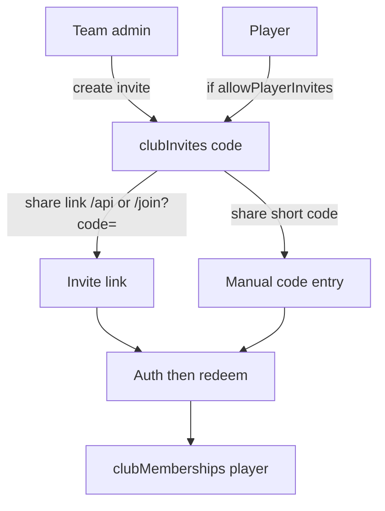

# White-label clubs (multi-tenant membership)

Plan to move Soccerville from a single hard-coded club to multi-club tenancy: rename global `admin` → `super_user`, add club-scoped `team_admin` / player memberships, invite join (link + code), membership backfill onto a club created by a super user, and profile surfaces for clubs / admin teams.

## Status

| Field | Value |
|-------|-------|
| Status | planned |
| Owner session | plan-feature (initial) |
| Last updated | 2026-09-16 |
| Related PR / branch | `cursor/white-label-clubs-plan-8b9d` |

## Goals (v1)

- **Global role rename** — Replace `admin` with `super_user` everywhere (types, APIs, Firestore rules, UI). No elaborate role backfill; only ~3 current admins (one-shot update or manual is fine).
- **Club entity** — Introduce a first-class **club** (org / white-label tenant). Code and collections use `club` to avoid colliding with match lineup [`types/team.ts`](../../types/team.ts) (`matches/{matchId}/teams`).
- **Membership roles** — A user may belong to many clubs. Per club, role is `player` or `team_admin` (and can differ across clubs). Global `super_user` is orthogonal and not club-scoped.
- **Join via invite** — Club members join through invite **link** or **code**. Team admins always can invite. Players can invite only when the club’s team admin enables “players can invite.”
- **Membership backfill** — After a super user creates the first club (current Soccerville), migrate all existing users onto that club as memberships (players; former global admins → `super_user` globally + `team_admin` on that club unless product decides otherwise).
- **Profile** — Show clubs the user belongs to. Show clubs where they are `team_admin`. From an admin club, share invite link / code.
- **Out of scope for v1:** QR invites, custom branding (logo/colors/domain), billing, cross-club match discovery marketplace, changing match-lineup “team” naming.

## Todos

1. Lock naming: **club** = tenant; keep match **teams** as lineup sides; UI copy may say “club” or “team” per product preference (see Critical decisions).
2. Data model: `clubs`, `clubMemberships`, `clubInvites`; strip club-scoped meaning from `users.role` (only `user` | `super_user`).
3. Auth helpers: `verifySuperUser`, `verifyClubTeamAdmin(clubId)`, membership loaders; update [`firestore.rules`](../../firestore.rules).
4. Rename `admin` → `super_user` across types, [`lib/api/auth.ts`](../../lib/api/auth.ts), [`useAdmin`](../../lib/hooks/useAdmin.ts) (or rename hook), Admin UI labels, UserRoleManager, tests.
5. Club CRUD APIs (super user creates clubs; team admin updates club settings including `allowPlayerInvites`).
6. Invite APIs: create/revoke invite; redeem by code or link token on register/login; enforce `allowPlayerInvites`.
7. Registration/login join path: accept `?invite=` / code entry; attach membership after auth.
8. One-shot migration script/route (super-user gated): given `clubId`, create memberships for all existing users; set former `admin` → `super_user` + `team_admin` on that club.
9. Profile UI: membership list + “clubs I admin” + invite share (copy link / code).
10. Scope reads for matches (and related lists) to the user’s active / selected club — minimum isolation so clubs do not see each other’s matches (see Design → Data isolation).
11. Tests for role checks, invite redeem, migration idempotency; update [`docs/IMPLEMENTATION_PLAN.md`](../IMPLEMENTATION_PLAN.md) role docs lightly if touched.

## Current state

Single-tenant pickup app branded Soccerville. No club/tenant/membership/invite collections.

| Area | Today |
|------|--------|
| Global roles | [`types/user.ts`](../../types/user.ts): `UserRole = 'user' \| 'admin'` |
| Role enforcement | [`lib/api/auth.ts`](../../lib/api/auth.ts) `verifyAdmin`; [`firestore.rules`](../../firestore.rules); [`useAdmin`](../../lib/hooks/useAdmin.ts); [`AdminRouteGuard`](../../components/admin/AdminRouteGuard.tsx) |
| Role mutation | [`UserRoleManager`](../../components/admin/UserRoleManager.tsx), [`PATCH /api/users/[userId]`](../../app/api/users/[userId]/route.ts) |
| “Team” | Match lineup only: [`types/team.ts`](../../types/team.ts), `matches/{matchId}/teams` |
| Join | Open [`RegisterForm`](../../components/auth/RegisterForm.tsx) → always `role: 'user'` ([`userService.createUser`](../../lib/services/userService.ts)) |
| Profile | [`app/profile/page.tsx`](../../app/profile/page.tsx): name, jersey, position, attendance — no clubs |
| Branding | Hard-coded Soccerville strings/URLs; not configurable |

Related feature plans (`check-in`, pitch lineup, RSVP, QStash) assume global admin and a shared match universe. They do not block this plan but will need club-scoped auth once isolation lands.

## Design

### Naming

| Term | Meaning |
|------|---------|
| **Club** | Tenant / org players belong to (Firestore `clubs`). Prefer this in code. |
| **Team admin** | Club-scoped role name in product (`team_admin` in data). |
| **Match team** | Existing lineup side under a match. Unchanged. |
| **Super user** | Global platform operator (`super_user`). Replaces `admin`. |

If product copy prefers “team” for the tenant (“create a team”), map UI strings → `club` entity; do not rename match `teams` collections.

### Role model

```text
users.role: 'user' | 'super_user'     // global only
clubMemberships.role: 'player' | 'team_admin'  // per club
```

- Capability checks:
  - Platform admin surfaces (`/admin` seed, cross-club tools, create club): `users.role === 'super_user'`.
  - Club settings, invites (always), club-scoped match admin actions: membership `team_admin` for that `clubId` **or** `super_user`.
- A user can be `team_admin` of club A and `player` of club B simultaneously.
- Do **not** store multiple global roles on `users.role`; membership is the source of truth for club roles.

### Data model

```ts
// clubs/{clubId}
interface Club {
  id: string
  name: string
  slug: string // unique, URL-safe
  createdBy: string // uid
  settings: {
    allowPlayerInvites: boolean // default false
  }
  // v1 optional: activeInviteCode cached on club for “share code”
  createdAt: Date
  updatedAt: Date
}

// clubMemberships/{membershipId}  — or clubs/{clubId}/members/{uid}
interface ClubMembership {
  id: string
  clubId: string
  userId: string
  role: 'player' | 'team_admin'
  status: 'active' // room for invited/suspended later
  joinedAt: Date
  updatedAt: Date
}

// clubInvites/{inviteId}
interface ClubInvite {
  id: string
  clubId: string
  code: string // short human code AND token segment in link
  createdBy: string
  createdByRole: 'team_admin' | 'player' | 'super_user'
  maxUses: number | null
  useCount: number
  expiresAt: Date | null
  revokedAt: Date | null
  createdAt: Date
}
```

**Indexes:** unique `(clubId, userId)` on memberships; unique `clubs.slug`; unique active `clubInvites.code` (or codes collection keyed by code).

**Recommendation:** top-level `clubMemberships` with composite indexes for `userId` and `clubId` (profile “my clubs” and “club roster” both matter).

### Invite UX



- Link shape: `/join?code=ABCD12` (works logged-out → register/login → redeem).
- Same `code` powers link and manual entry.
- Redeem is idempotent if already a member.
- Revoke sets `revokedAt`; expired / maxed invites fail closed.
- QR codes: generate from the same URL later; no v1 work.

### Profile UX ([`app/profile/page.tsx`](../../app/profile/page.tsx))

1. **Clubs I’m in** — list memberships (name + role badge).
2. **Clubs I admin** — filter `role === 'team_admin'` (may overlap). Actions: copy invite link, copy code, toggle `allowPlayerInvites` (settings).
3. Keep existing profile fields / attendance as-is for v1 (attendance may stay global until match scoping is solid; prefer club-scoped stats only if cheap).

### Super user + first club + backfill

1. Deploy role rename; update the ~3 `admin` docs to `super_user` (script or console).
2. Super user creates club (e.g. “Soccerville”) via admin UI or API.
3. Run membership backfill with that `clubId`:
   - Every existing user → `clubMemberships` with `player` (or `team_admin` if they were `admin` / `super_user`).
   - Idempotent on `(clubId, userId)`.
4. No need to invent historical invite rows.

### Data isolation (minimum for white-label)

Without scoping, new clubs share one match list — not white-label.

**v1 minimum:**

- Add `clubId` to `matches` (and likely `schedules`, `savedLocations` as used by that club).
- Backfill existing matches/schedules/locations → first club id.
- List/detail APIs and Firestore rules: caller must be a member of `match.clubId` (super user may bypass or use an “active club” context).
- Active club: store `users.activeClubId` or client selection in profile/nav; default to sole membership or first club.

Full white-label branding (per-club name in nav, theme) can follow once membership + isolation work.

### API sketch

| Endpoint | Auth | Purpose |
|----------|------|---------|
| `POST /api/clubs` | super user | Create club |
| `PATCH /api/clubs/[clubId]` | team admin / super user | Name/settings (`allowPlayerInvites`) |
| `GET /api/clubs/mine` | authed | Memberships for profile |
| `POST /api/clubs/[clubId]/invites` | team admin, or player if allowed | Create invite |
| `POST /api/invites/redeem` | authed | Join by code |
| `POST /api/admin/backfill-club-memberships` | super user | One-shot membership + role migration |
| Existing admin match routes | team admin for that club **or** super user | Gradually replace bare `verifyAdmin` |

### Auth migration pattern

Replace [`verifyAdmin`](../../lib/api/auth.ts) call sites in two waves:

1. **Wave A (platform):** seed, cross-tenant user role manager, create club → `verifySuperUser`.
2. **Wave B (club ops):** match CRUD, locations, schedules, host check-in, team generate → `verifyClubTeamAdmin(clubId)` with `clubId` from resource.

Until Wave B is done, do not open multi-club create to arbitrary users in production (or gate match writes to super user only).

## Critical decisions

1. **Entity name = `club` in code** even if UI says “team,” so match lineup `teams` stay unambiguous.
2. **Roles are membership-scoped** except `super_user`. Do not put `team_admin` on `users.role`.
3. **Former `admin` → `super_user` + `team_admin` on the founding club** so today’s operators keep club powers after isolation.
4. **Player invites default off** (`allowPlayerInvites: false`).
5. **Do not break open registration entirely in v1** until invite-only is product-ready: either require invite code to create an account that lands in a club, or allow account create without club (profile prompts to join). Prefer **invite required to join a club**; orphan accounts without membership see an empty state + join UI.
6. **Match `clubId` backfill is required** with the membership backfill (same founding club), or multi-club ships broken.

## Files to touch

| Path | Change |
|------|--------|
| [`types/user.ts`](../../types/user.ts) | `UserRole = 'user' \| 'super_user'`; optional `activeClubId` |
| New `types/club.ts` | Club, membership, invite types |
| [`lib/api/auth.ts`](../../lib/api/auth.ts) | `verifySuperUser`, club admin helpers |
| [`firestore.rules`](../../firestore.rules) | Club/membership/invite rules; match reads by membership |
| [`lib/hooks/useAdmin.ts`](../../lib/hooks/useAdmin.ts) | Super-user detection; add membership hooks |
| [`components/admin/*`](../../components/admin/) | Labels admin → super user; club create; role manager |
| [`app/profile/*`](../../app/profile/), [`components/profile/*`](../../components/profile/) | Clubs lists + invite share |
| New `app/join/page.tsx` | Redeem invite link / code entry |
| New `app/api/clubs/**`, `app/api/invites/**` | CRUD + redeem + backfill |
| [`types/match.ts`](../../types/match.ts) + match APIs | `clubId` + scoped queries |
| [`components/auth/RegisterForm.tsx`](../../components/auth/RegisterForm.tsx) | Invite-aware registration |
| Tests colocated with auth, invites, migration | |

## Acceptance criteria

- [ ] No remaining `role === 'admin'` / `UserRole` `'admin'` in app code; platform checks use `super_user`.
- [ ] Super user can create a club; founding club receives backfilled memberships for all existing users (idempotent).
- [ ] Former admins are `super_user` globally and `team_admin` on the founding club.
- [ ] User can belong to multiple clubs with different membership roles.
- [ ] Team admin can create invite link + code; player can only when `allowPlayerInvites` is true.
- [ ] Redeeming a valid invite adds an active `player` membership; invalid/revoked/expired codes fail clearly.
- [ ] Profile lists clubs joined and clubs administered; admin section exposes share link/code.
- [ ] Matches (existing + new) carry `clubId`; users only see matches for clubs they belong to (super user escape hatch documented).
- [ ] QR codes and per-club branding are not required for v1 done.

## Later

- QR code generation for invite URLs.
- White-label branding: club display name in nav, logo, colors, custom domain.
- Invite-only registration (disable orphan accounts).
- Promoting/demoting `team_admin` from club roster UI; transfer ownership.
- Club-scoped attendance stats and analytics.
- Removing hard-coded Soccerville copy behind club settings.

## Handoff

> Updated by `/handoff`. `/feature-context` reads this first.

### Done so far

- None yet (plan only).

### Remaining work

- Mirror open Todos; start with naming lock + types/`users.role` rename design, then `clubs` / `clubMemberships` / `clubInvites` schema, then auth helpers before UI.
- Product should confirm UI copy: “club” vs “team” for the tenant, and whether orphan accounts (no membership) are allowed at register.

### Blockers / risks

- Large blast radius: every `verifyAdmin` call site and Firestore rule assuming a single shared match universe.
- Naming collision if “team” is used for both tenant and lineup.
- Shipping memberships without `match.clubId` isolation leaks data across clubs.

### Pointers for the next agent

- Start at: this doc → implement `types/club.ts` + `UserRole` rename in [`types/user.ts`](../../types/user.ts) + [`lib/api/auth.ts`](../../lib/api/auth.ts).
- Do not: put `team_admin` on the global `users.role` field; do not rename match lineup `teams`.
- Verify with: unit tests for invite redeem + migration idempotency; manual profile invite copy + join flow; confirm founding-club match list still works after `clubId` backfill.
- Next skills: `/feature-context` on this file before coding; `/handoff` when a session ends or status changes.
