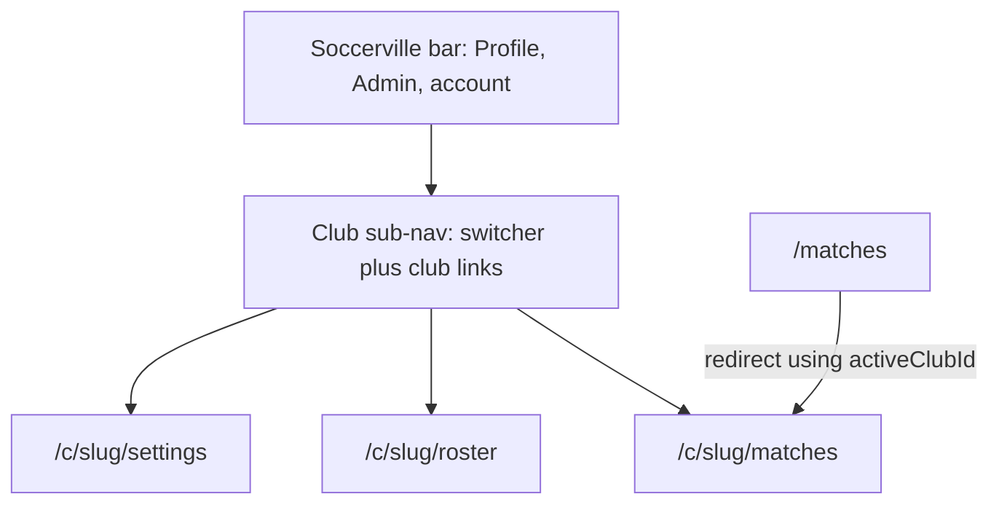

# White-label clubs v2

Plan for the follow-ups listed under Later in the [v1 white-label plan](./white-label-clubs-feature-plan.md): flag club creation, rebuild navigation around the selected club, then add club branding and the remaining club-admin surfaces. v1 tenancy stays as shipped.

## Status

| Field | Value |
|-------|-------|
| Status | in progress |
| Owner session | cloud agent (club-admin console) |
| Last updated | 2026-09-27 |
| Related PR / branch | [#83](https://github.com/orkunozekin/soccer-team-builder/pull/83) `cursor/club-admin-console-6473` (todo 4). Prior: [#82](https://github.com/orkunozekin/soccer-team-builder/pull/82) slug matches, [#80](https://github.com/orkunozekin/soccer-team-builder/pull/80) club sub-nav, [#79](https://github.com/orkunozekin/soccer-team-builder/pull/79) `club-creation`. Continues [v1 plan](./white-label-clubs-feature-plan.md) (merged [#65](https://github.com/orkunozekin/soccer-team-builder/pull/65), [#71](https://github.com/orkunozekin/soccer-team-builder/pull/71), [#73](https://github.com/orkunozekin/soccer-team-builder/pull/73), [#74](https://github.com/orkunozekin/soccer-team-builder/pull/74), [#76](https://github.com/orkunozekin/soccer-team-builder/pull/76)) |

## Goals (v1 of this plan)

Ship in this order. Later numbers wait until the nav shell exists.

- **Flag club creation first.** LaunchDarkly boolean `club-creation`, fail-closed. Hide the create form and reject `POST /api/clubs` while the flag is off.
- **Soccerville bar + club sub-nav.** Platform chrome stays Soccerville. A second bar shows the current club and club-only links. This is the priority after the flag, and it lands before branding.
- **Club URLs.** Selected club lives in `/c/[slug]/…`. `users.activeClubId` remains the fallback for legacy URLs.
- **Club sub-nav is the club-admin console.** Matches, roster, invites, and settings. Profile stays personal.
- **Branding on the club bar.** Logo, display name, and one primary color on the sub-nav. Soccerville chrome stays Soccerville.
- **Remaining v1 Later items.** QR invites, invite-only registration, ownership transfer, club-scoped attendance, club-context copy. Custom domain is last and is its own slice.
- **Out of scope for v1:** billing, a cross-club match marketplace, renaming match-lineup teams, a command palette, a sidebar layout, a searchable club switcher, restyling the Soccerville bar with club colors, re-running the founding-club backfill.

## Todos

1. [x] Feature-flag club creation (`club-creation`, default off) on the admin form and on `POST /api/clubs`.
2. [x] Split the shell into a Soccerville platform bar and a club sub-nav with a club switcher.
3. [x] Move member match pages to `/c/[slug]/…` and redirect legacy `/matches` URLs.
4. [x] Move roster, invites, and club settings onto the club sub-nav (club-admin console).
5. [ ] Add club logo, display name, and primary color on the club sub-nav only.
6. [ ] QR code for the existing invite URL.
7. [ ] Invite-only registration behind `invite-only-registration` (default off).
8. [ ] Club ownership transfer (`createdBy`), leaving at least one `club_admin`.
9. [ ] Club-scoped attendance stats for the selected club.
10. [ ] Replace hard-coded Soccerville strings that sit in club context (match page titles).
11. [ ] Custom domain (last; separate slice after nav and branding).

## Current state

v1 tenancy is on `main`. Founding club is Jax State Soccer Club. Promote/demote and invite revoke shipped in #74. Active-club preference shipped in #76.

| Area | Today |
|------|--------|
| Shell | Sticky [`AppShell`](../../components/layout/AppShell.tsx): Soccerville platform bar ([`Navigation.tsx`](../../components/layout/Navigation.tsx): wordmark → `/matches` redirect, Profile, Admin for `super_user`, Sign out) plus signed-in [`ClubSubNav`](../../components/layout/ClubSubNav.tsx) (club switcher; Matches; Roster / Invites / Settings by role; Join; Create club when `club-creation` + super user). Signed-out: centered wordmark only. |
| Selected club | URL slug on `/c/[slug]/…` is source of truth for that tab. Switcher writes `users.activeClubId` via `PATCH /api/users/me` for legacy redirects ([`resolveClubMembershipForPath`](../../lib/utils/clubPaths.ts)). |
| Match pages | Canonical: [`app/c/[slug]/matches`](../../app/c/[slug]/matches/page.tsx) + match detail. Legacy [`/matches`](../../app/matches/page.tsx) and [`/matches/[matchId]`](../../app/matches/[matchId]/page.tsx) redirect. Access via [`useClubSlugAccess`](../../lib/hooks/useClubSlugAccess.ts); super users without membership use [`GET /api/clubs/by-slug/[slug]`](../../app/api/clubs/by-slug/[slug]/route.ts). |
| Club admin UI | Canonical: [`/c/[slug]/roster`](../../app/c/[slug]/roster/page.tsx), [`invites`](../../app/c/[slug]/invites/page.tsx), [`settings`](../../app/c/[slug]/settings/page.tsx) via [`components/club/*`](../../components/club/) + [`useClubSectionAccess`](../../lib/hooks/useClubSectionAccess.ts). Profile keeps membership list + links ([`ProfileClubsSection`](../../components/profile/ProfileClubsSection.tsx)). Platform admin stays [`/admin/*`](../../app/admin/layout.tsx). |
| Club create | Super-user form [`components/admin/ClubAdminPanel.tsx`](../../components/admin/ClubAdminPanel.tsx) on [`app/admin/users/page.tsx`](../../app/admin/users/page.tsx). Hidden unless `club-creation` is on. `POST` [`app/api/clubs/route.ts`](../../app/api/clubs/route.ts) uses `verifySuperUser` then `evaluateFeatureFlag('club-creation')` (403 when off). |
| Flags | Client: `launchdarkly-react-client-sdk` + [`useFeatureFlag`](../../lib/flags/useFeatureFlag.ts). Server: `@launchdarkly/node-server-sdk` via [`lib/flags/evaluateFeatureFlag.ts`](../../lib/flags/evaluateFeatureFlag.ts). Keys in [`lib/flags/featureFlags.ts`](../../lib/flags/featureFlags.ts): `pitch-lineup-view`, `club-creation` (both default false). Local overrides: `NEXT_PUBLIC_FF_PITCH_LINEUP_VIEW`, `NEXT_PUBLIC_FF_CLUB_CREATION`. |
| Club fields | [`types/club.ts`](../../types/club.ts): `name`, `slug`, `settings.allowPlayerInvites`. Patch: [`app/api/clubs/[clubId]/route.ts`](../../app/api/clubs/[clubId]/route.ts) (`verifyClubAdmin`). |
| Attendance | [`components/profile/AttendanceStatsCard.tsx`](../../components/profile/AttendanceStatsCard.tsx) loads every match for the user. |
| Copy | “Soccerville” is hard-coded in the nav, [`app/layout.tsx`](../../app/layout.tsx) metadata, login/register/forgot-password, and password-reset email. |

## Design

### Research (nav)

Compared common multi-workspace shells (Clarity header + subnav, GitHub global bar + context bar, Atlassian top bar vs sidebar, path-scoped workspace URLs such as Slack, Notion, and Linear):

- Soccerville stays the platform brand. A switcher that replaces the logo fights that.
- A left sidebar fits dense multi-project tools. This app is mobile-first and the club surface is a short list, so a **header plus a sub-nav** is the fit. A sidebar would take the phone content area. Header + sub-nav + sidenav stacked is the combination to avoid.
- The club switcher sits on the **left of the club sub-nav**, not among the Soccerville links. Platform chrome stays stable. “You are in this club” starts the club links.
- The selected club belongs in the path (`/c/[slug]/…`). `activeClubId` alone changes every open tab at once. Keep `activeClubId` as the fallback when a legacy URL has no slug.
- Skip a command palette. Most users have one club. Add search inside the menu only if a user later has many clubs.



### 1. Feature flag `club-creation`

Follow the `pitch-lineup-view` pattern.

| Piece | Choice |
|-------|--------|
| Key | `club-creation` (kebab-case, same as the LaunchDarkly dashboard) |
| Default | `false` in [`FEATURE_FLAG_DEFAULTS`](../../lib/flags/featureFlags.ts) and in the dashboard |
| Client | Add the key to `FEATURE_FLAG_KEYS`. Hide [`ClubAdminPanel`](../../components/admin/ClubAdminPanel.tsx) when `useFeatureFlag('club-creation')` is false (omit the card). |
| Local override | `NEXT_PUBLIC_FF_CLUB_CREATION=true` in `getLocalFeatureFlagOverrides`. Dev/demo only. Document next to the pitch override in [`.env.sample`](../../.env.sample). |
| Server | Add `@launchdarkly/node-server-sdk`. Evaluate with `LAUNCHDARKLY_SDK_KEY`. Missing key, init failure, or a missing flag returns false. |
| API | After `verifySuperUser` succeeds, `POST /api/clubs` returns 403 with a stable message (`Club creation is unavailable`) when the flag is off. Client hiding alone leaves the route open. |
| Errors | Pass unexpected failures through [`sanitizeErrorForClient`](../../lib/api/sanitizeError.ts). Log the raw error on the server. |
| Tests | Helper fails closed without a key. Route test: super user + flag off → 403; flag on → existing create behavior (mock the flag helper). |

Create the boolean flag in LaunchDarkly (default off) before relying on the dashboard. Until then, local override or the fail-closed default applies.

The nav “Create club” item in the next section uses this same flag. Build the flag first so that item has a key to read.

### 2. Two-level navigation

Signed-in shell, top to bottom:

1. **Platform bar** (existing red Soccerville chrome). Wordmark links to the user’s club matches (legacy `/matches` redirect is fine). Links: Profile, Admin only when [`useAdmin`](../../lib/hooks/useAdmin.ts) is true (`super_user`), account / Sign out. Matches leaves this bar.
2. **Club sub-nav**, directly under the platform bar, signed-in only.
   - Left: current club name and a chevron. Show the name even when the user has one membership.
   - Menu: memberships (club name + `player` / `club_admin`), current club marked, Join a club (`/join`). Create club only when `club-creation` is on and the user is a super user (opens the existing admin create flow, still the flagged form on `/admin/users`).
   - Links: Matches (every member), Roster (`club_admin`), Invites (`club_admin`, or a player when `settings.allowPlayerInvites`), Settings (`club_admin`).
3. **Signed-out:** keep today’s centered Soccerville header. No sub-nav.
4. **No membership:** sub-nav is a Join prompt, not an empty switcher.
5. **Super user:** the menu lists that user’s memberships. It does not list every club in the product. Creating a club stays the flagged admin form. A super user who types `/c/[slug]` still passes `verifyClubMember` / `verifyClubAdmin`, which already treat super users as allowed.
6. **Mobile:** platform bar keeps the current menu button. Below `sm`, the sub-nav uses a full-width club select plus a section select, matching [`AdminNav`](../../components/admin/AdminNav.tsx).

Profile “Set as active” can stay until the switcher ships, then become a secondary control or be removed so the sub-nav is the place people change clubs.

### 3. Club routes

Canonical pages:

| Path | Who | Replaces |
|------|-----|----------|
| `/c/[slug]/matches` | member (or super user) | [`app/matches/page.tsx`](../../app/matches/page.tsx) |
| `/c/[slug]/matches/[matchId]` | member (or super user) | [`app/matches/[matchId]/page.tsx`](../../app/matches/[matchId]/page.tsx) |
| `/c/[slug]/roster` | `club_admin` or super user | roster block on profile |
| `/c/[slug]/invites` | `club_admin`, or player if `allowPlayerInvites` | invite block on profile |
| `/c/[slug]/settings` | `club_admin` or super user | `allowPlayerInvites` on profile; branding fields land here in todo 5 |

Rules:

- Resolve `slug` → club. Unknown slug: 404. Caller is not a member and is not a super user: 404 (do not confirm the club exists).
- `/matches` redirects to `/c/{slug}/matches`. `/matches/[matchId]` redirects to `/c/{slug}/matches/[matchId]` when the match `clubId` resolves to a slug the caller may open. Slug source: `activeClubId` when it is an active membership, otherwise the sole membership. No membership: send the user to `/join`.
- Switching clubs calls the existing `PATCH /api/users/me` with `activeClubId`, then navigates to the same section on the new slug. If the new role cannot open that section (player hitting roster), land on matches.
- Leave `/api/matches` and `/admin/*` where they are. Platform admin match tools stay on the super-user shell.
- Login, register, and join defaults that push `/matches` can keep that path; the redirect carries them into the club URL.
- Update in-app links (nav, match back link, join success) to the slug path once the redirect exists, so the address bar shows the club.

### 4. Club-admin console

The sub-nav is the console. Do not add a second admin area.

- Roster: move [`ClubAdminRoster`](../../components/profile/ClubAdminRoster.tsx) to `/c/[slug]/roster`.
- Invites and `allowPlayerInvites`: move off [`ProfileClubsSection`](../../components/profile/ProfileClubsSection.tsx) onto `/c/[slug]/invites` and `/c/[slug]/settings`.
- Profile keeps account fields and attendance until todo 9 scopes attendance.
- Page handlers and server calls keep using [`verifyClubAdmin`](../../lib/api/auth.ts) / `verifyClubMember`. Hiding a nav link is not authorization.

### 5. Branding on the club bar

After the shell exists, extend `ClubSettings` in [`types/club.ts`](../../types/club.ts):

```ts
branding?: {
  displayName?: string // fallback: club.name
  logoUrl?: string
  primaryColor?: string // #rrggbb
}
```

- Write through `PATCH /api/clubs/[clubId]` (`verifyClubAdmin` or super user). Reject anything that is not a trimmed display name, an `https` logo URL, or a `#` + 6 hex digits. No arbitrary CSS.
- Apply logo, display name, and primary color on the **club sub-nav** only (CSS variables on that bar). Platform bar, auth screens, and password-reset mail stay Soccerville red / Soccerville copy.
- Settings page is where a club admin edits these fields.

### Todos 6 to 10. Remaining v1 Later items

Do these after the nav shell and the branding fields exist.

- **QR invites.** Render a QR for the invite link the API already returns (`/join?code=`). Same token as copy-link. Client-only. No new invite type.
- **Invite-only registration.** Flag `invite-only-registration`, default off, same client + server fail-closed pattern. When on, account create requires an invite code and redeems it. `/register` without a code explains how to join. When off, today’s orphan-account path stays.
- **Ownership transfer.** Promote/demote already exists (`PATCH /api/clubs/[clubId]/members/[userId]`). Add a transfer that sets `clubs.createdBy` to another user who is, or becomes, `club_admin`. Actor is the current `createdBy` or a super user. The club still has at least one `club_admin` (existing demote guard).
- **Club-scoped attendance.** [`AttendanceStatsCard`](../../components/profile/AttendanceStatsCard.tsx) counts matches for the selected club (`clubId` from the slug, or `activeClubId` if the card stays on profile). Label the card with the club name.
- **Club-context copy.** Match page titles and headings that say Soccerville in a club view use the club display name. Platform chrome, auth screens, and email from-name stay Soccerville.

### 11. Custom domain (last)

Separate slice. Do not start it in the nav or branding PRs. It needs a host → club mapping, Vercel domain setup, and a product choice about which chrome a custom domain shows. Until that choice is made, every host uses the Soccerville platform bar plus the club sub-nav.

## Critical decisions

1. `club-creation` defaults off in code and in LaunchDarkly. The dashboard flag is what exposes create.
2. The selected club is the URL slug. `activeClubId` is the legacy default, written on switch so old URLs still resolve.
3. Club color and logo paint the club sub-nav. They do not restyle the Soccerville bar in this version.
4. AuthZ stays on [`lib/api/auth.ts`](../../lib/api/auth.ts). New pages call the same club-admin and member checks.
5. Do not put `club_admin` on `users.role`. Do not rename match-lineup `teams`. Do not re-run the founding-club backfill.
6. Local work uses Firebase emulators only.

## Likely files

Starting map only. Touch any other files the work needs: tests, hooks, services, redirects, and call sites that still assume `/matches` or a single header.

| Path | Change |
|------|--------|
| [`lib/flags/featureFlags.ts`](../../lib/flags/featureFlags.ts) | `club-creation` and later `invite-only-registration`; local `NEXT_PUBLIC_FF_*` overrides |
| [`lib/flags/useFeatureFlag.ts`](../../lib/flags/useFeatureFlag.ts) | No API change; new keys flow through the existing hook |
| New server flag helper under `lib/flags/` | Node SDK evaluation, fail closed |
| [`.env.sample`](../../.env.sample) | Document `NEXT_PUBLIC_FF_CLUB_CREATION`, `LAUNCHDARKLY_SDK_KEY`, later invite-only override |
| [`components/admin/ClubAdminPanel.tsx`](../../components/admin/ClubAdminPanel.tsx) | Hide when the flag is off |
| [`app/api/clubs/route.ts`](../../app/api/clubs/route.ts) | 403 when the flag is off; sanitize unexpected errors |
| [`components/layout/Navigation.tsx`](../../components/layout/Navigation.tsx) | Platform bar only; drop Matches from this bar |
| New club sub-nav component next to Navigation | Switcher + club links; mobile selects |
| [`app/layout.tsx`](../../app/layout.tsx) | Mount the sub-nav under `Navigation` |
| New `app/c/[slug]/…` pages | Matches, match detail, roster, invites, settings |
| [`app/matches/page.tsx`](../../app/matches/page.tsx), [`app/matches/[matchId]/page.tsx`](../../app/matches/[matchId]/page.tsx) | Redirect to the slug URLs |
| [`components/profile/ProfileClubsSection.tsx`](../../components/profile/ProfileClubsSection.tsx) | Drop roster/invites/settings once those routes exist |
| [`types/club.ts`](../../types/club.ts), [`app/api/clubs/[clubId]/route.ts`](../../app/api/clubs/[clubId]/route.ts) | Branding fields, validated |
| [`components/profile/AttendanceStatsCard.tsx`](../../components/profile/AttendanceStatsCard.tsx) | Filter to the selected club |
| Register / login join path | Invite-only flag when that todo starts |

## Acceptance criteria

- [x] With `club-creation` off, super users do not see the create form and `POST /api/clubs` returns 403. With the flag on (or `NEXT_PUBLIC_FF_CLUB_CREATION=true`), create still works for a super user. Missing server SDK key fails closed.
- [x] Signed-in users see a Soccerville platform bar and a club sub-nav. The sub-nav shows the current club and switches clubs. Matches is on the sub-nav. Profile and super-user Admin stay on the platform bar.
- [x] Signed-out users still see the centered Soccerville header. Users with no club see a Join prompt on the sub-nav.
- [x] `/c/[slug]/matches` is the match list for that club. `/matches` redirects there from `activeClubId` or the sole membership. A non-member slug 404s.
- [x] Switching clubs updates `activeClubId` and the URL. Two tabs can show two clubs.
- [x] Roster, invites, and settings are reachable from the sub-nav for the roles above, and the APIs still enforce `verifyClubAdmin` / the invite gate.
- [ ] Club logo, display name, and primary color appear on the sub-nav. The Soccerville bar stays the platform red. Invalid color or logo values are rejected.
- [ ] Invite QR encodes the existing `/join?code=` URL.
- [ ] `invite-only-registration` off preserves open registration. On, registration requires a code.
- [ ] Ownership transfer updates `createdBy` and cannot remove the last `club_admin`.
- [ ] Attendance stats on the selected club ignore other clubs’ matches.
- [ ] Club match titles use the club display name. Auth screens and password-reset mail still say Soccerville.
- [ ] Custom domain is not required for the todos above.

## Later

- Custom domain host mapping and the chrome choice for that host (todo 11). Do not fold it into the nav PR.
- Search inside the club menu, only if real users belong to many clubs.
- Command palette and a sidebar shell. Revisit only if the sub-nav stops fitting.

## Handoff

> Updated by `/handoff`. `/feature-context` reads this first.

### Done so far

- Plan drafted; v1 sibling unchanged.
- **`club-creation` flag** merged in [#79](https://github.com/orkunozekin/soccer-team-builder/pull/79).
- **Platform bar + club sub-nav (todo 2)** merged in [#80](https://github.com/orkunozekin/soccer-team-builder/pull/80).
- **Club slug match routes (todo 3)** merged in [#82](https://github.com/orkunozekin/soccer-team-builder/pull/82).
- **Club-admin console (todo 4) on `cursor/club-admin-console-6473`:**
  - Pages: [`app/c/[slug]/roster`](../../app/c/[slug]/roster/page.tsx), [`invites`](../../app/c/[slug]/invites/page.tsx), [`settings`](../../app/c/[slug]/settings/page.tsx).
  - UI: [`ClubAdminRoster`](../../components/club/ClubAdminRoster.tsx) (members only), [`ClubInvitesPanel`](../../components/club/ClubInvitesPanel.tsx), [`ClubSettingsPanel`](../../components/club/ClubSettingsPanel.tsx), shared [`ClubSectionPage`](../../components/club/ClubSectionPage.tsx).
  - Gate: [`useClubSectionAccess`](../../lib/hooks/useClubSectionAccess.ts) + [`canAccessClubSection`](../../lib/utils/resolveSelectedClub.ts). Non-members → 404; members without role → redirect to matches.
  - Sub-nav always lists role-appropriate Roster / Invites / Settings (`includeClubAdminSections` removed).
  - Profile “Clubs I manage” is links only; roster/invite/settings controls removed from profile.
  - Path helpers: `clubRosterPath` / `clubInvitesPath` / `clubSettingsPath` in [`clubPaths.ts`](../../lib/utils/clubPaths.ts).

### Remaining work

1. Branding fields and sub-nav paint (todo 5).
2. QR, invite-only flag, ownership transfer, club-scoped attendance, club-context copy (todos 6–10).
3. Custom domain only after the above, as its own slice (todo 11).

### Blockers / risks

- Create the LaunchDarkly `club-creation` boolean (default off) in each environment dashboard, and set `LAUNCHDARKLY_SDK_KEY` in deployed server env. Until then, creation stays off unless `NEXT_PUBLIC_FF_CLUB_CREATION=true` (dev/demo).
- In-app links that still push `/matches` rely on the redirect (login/register/join/wordmark). Prefer updating call sites to slug paths when touching those files.
- Players with `allowPlayerInvites` can create invites but cannot list/revoke (GET/revoke still require `verifyClubAdmin`).

### Pointers for the next agent

- Start at: Design §5 (branding) — extend `ClubSettings` / `PATCH /api/clubs/[clubId]`, paint club sub-nav only.
- Do not: put `club_admin` on `users.role`; rename match `teams`; paint the Soccerville bar with club colors; point local Firebase at production; start custom domains.
- Verify with: `yarn vitest run lib/utils/clubPaths.test.ts lib/utils/resolveSelectedClub.test.ts components/layout/ClubSubNav.test.tsx components/club/*.test.tsx components/profile/ProfileClubsSection.test.tsx`
- Next skills: `/feature-context` on this file before coding; `/handoff` when a session ends or status changes.
